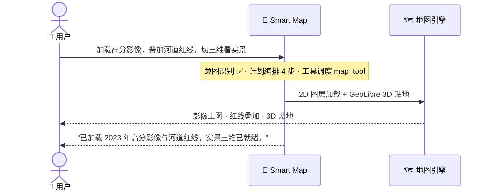
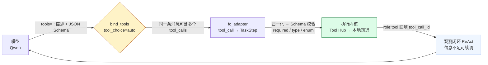
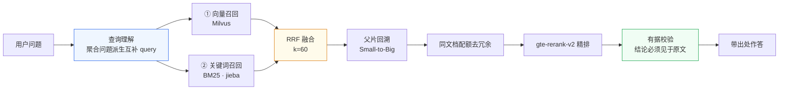
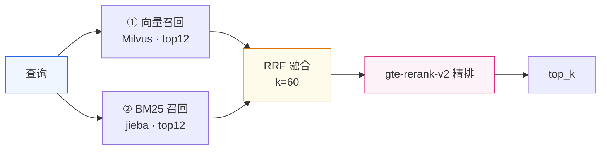
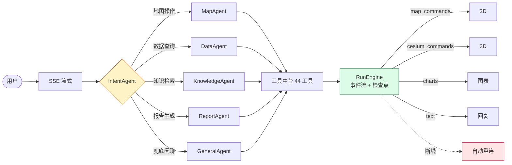
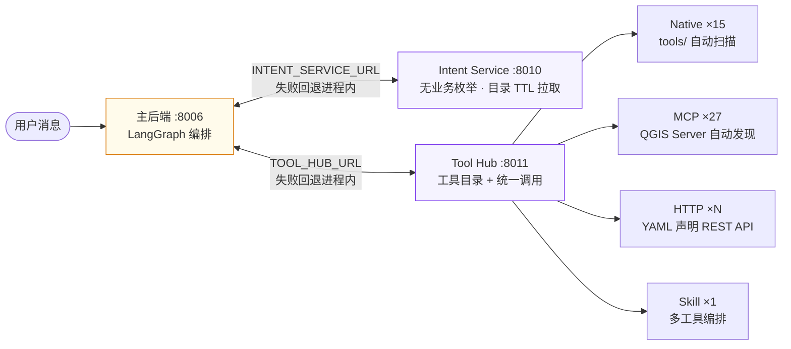
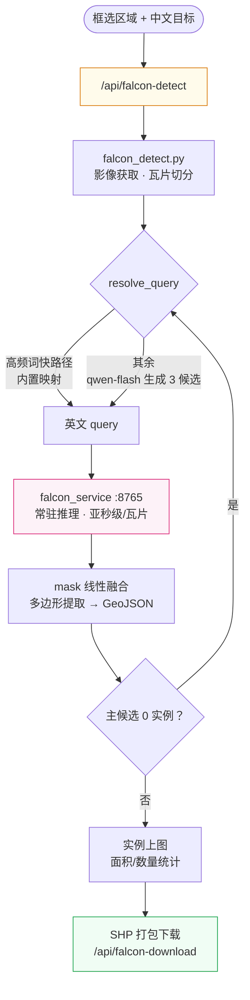
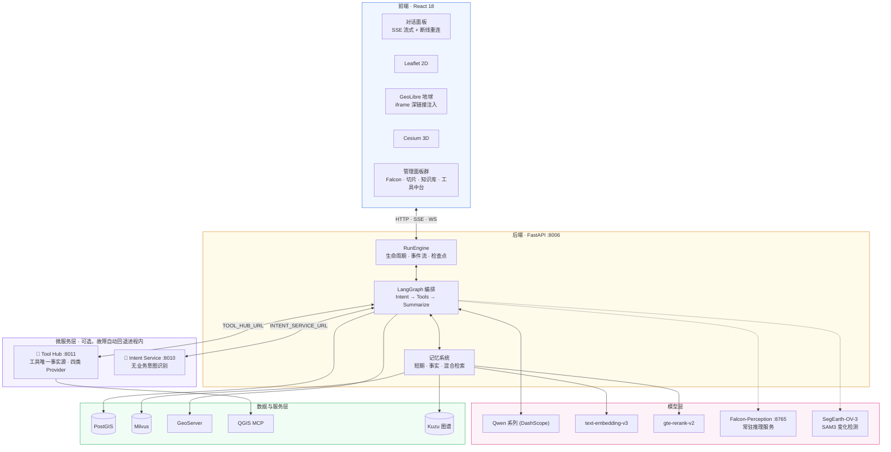

<div align="center">

# 🌊 Smart Map

**豫水智能一张图 · 面向水利空间治理的智能体系统**

把一句自然语言，编译为可校验、可恢复、可审计的空间计算工作流。

*A Spatial-Intelligence Agent over GIS Engines, Spatial-Analysis Tools and Hybrid-Retrieval Knowledge.*

[]()
[]()
[]()
[]()
[]()
[]()
[]()
[]()

[]()
[]()
[]()


对话即操作 · 越用越懂你 · 三引擎同屏 · 遥感识别开口即测

</div>

---

## 🎯 系统定位

系统把「一句话指令」编译为可执行的空间计算工作流：在语义层完成理解与规划，在执行层完成可校验、可恢复、可审计的工具调度。

| 层 | 职责 | 关键抽象 |
|----|------|----------|
| **认知层** | 理解用户意图，注入跨会话事实记忆 | 意图目录 · 结构化/原生双模识别 · 用户事实 |
| **编排层** | 把意图编译为可执行计划，并在执行前校验 | `TaskStep` 计划 · JSON Schema 校验 · preflight 语义规则 |
| **执行层** | 调度工具、并发执行、失败降级与恢复 | 工具中台 · 幂等键 `run_id::step_id::params_hash` · 检查点 |
| **表达层** | 把执行结果流式呈现为地图操作、图表与结论文本 | SSE 事件流 · 三引擎指令 · 有据回答 |

> [!IMPORTANT]
> **请求与执行严格分离**：模型只产出"调用请求"（计划或 `tool_calls`），任何副作用都发生在独立的执行内核中——带 Schema 校验、超时控制与幂等落盘。

---

## 🎬 它能做什么？

传统 GIS 的菜单地狱、命令行门槛、数据孤岛，在这里被压缩成一句自然语言。你说：

> "加载北汝河采区的高分影像，叠加河道红线，再切到三维看看实景"

系统自动完成意图识别、计划编排、工具调度与引擎联动：



更多典型场景：

| 场景 | 你说 | 系统做 |
|------|------|--------|
| 图层调度 | 把 2026 年采区边界和测深数据加到地图上 | 意图解码 → 计划编排 → 多图层批量上图 |
| 数据问答 | 种子场可采区去年采了多少方？ | PostGIS 查询 → 图表渲染 → 结论解读 |
| 政策检索 | 采砂现场监管有什么要求？ | 混合检索 RAG → 精排 → 带出处回答 |
| 空间分析 | 红线外 500 米缓冲区里有哪些采区？ | QGIS MCP 直驱 → 缓冲叠加 → 结果上图 |
| 遥感识别 | 在这个框里找出所有采砂坑 | Falcon 分割 → 实例上图 → SHP 一键下载 |
| 变化检测 | 对比这两期影像，河道有什么变化？ | SAM3 语义分割 → 双时相差异 → 侵占预警 |
| 报告生成 | 出一份本月监测报告 | 多源数据融合 → Word 自动成文 |

---

## ✨ 能力总览

| 能力域 | 提供的能力 | 关键机制 |
|--------|-----------|----------|
| **智能体运行时** | 意图识别 · 计划编排 · 多 Agent 分派 · 长任务流式执行 | LangGraph 状态图 · RunEngine 生命周期 · SSE 断线恢复 |
| **工具调用** | 44 个工具统一注册调度，模型可原生 `tool_call` 直调 | 工具描述 + JSON Schema 注入 · 参数校验 · 并行调用 · 观测闭环 |
| **知识检索** | 政策/方案类问答，带出处、拒幻觉 | 混合召回 · 父片回溯 · RRF 融合 · 精排 · 有据校验 |
| **记忆系统** | 会话上下文 · 跨会话知识 · 用户事实三层记忆 | 上下文预算 · 滚动压缩 · 事实抽取与注入 |
| **空间数据问答** | PostGIS 查询 → 图表渲染 → 结论解读 | 库表 Schema 单一来源 · 确定性读数 · 数据充分性检查 |
| **空间分析** | 缓冲区 · 叠加 · 裁剪等矢量分析 | QGIS MCP 直驱 · 参数化 Recipe |
| **三引擎地图** | 2D / 3D / 实景地球同屏联动，深链接动态注入图层 | Leaflet · Cesium · GeoLibre iframe 桥 |
| **遥感视觉** | 自由文本目标分割 · 双时相变化检测 · SHP 成果直出 | Falcon-Perception 常驻服务 · SegEarth-OV-3 SAM3 |
| **报告生成** | 多源数据融合，Word 报告自动成文 | RTK 测点 + 无人机影像 + 监测数据模板化渲染 |
| **生产可靠性** | 7×24 托管 · 灾备恢复 · 全链路降级 | PM2 · 每日备份 · 三级恢复 · 内存与 TTL 治理 |

---

## 🔧 智能体与工具调用

工具调用的完整生命周期——从工具描述注入模型，到模型生成调用请求，再到校验、执行与结果回填，全部显式可控：



| 环节 | 机制 | 价值 |
|------|------|------|
| **工具描述注入** | 工具声明的 `parameters` 自动渲染为机器可读 JSON Schema，经 `tools=` 注入模型；手写约束段作为语义覆盖层 | 参数不再依赖模型猜字段名 |
| **请求生成** | 双模：结构化输出生成 `execution_plan`，或 `bind_tools` 直接产出原生 `tool_calls`；后者一次可并行多个 | 一次请求即可表达多步意图 |
| **执行前校验** | 序列：参数归一化 → JSON Schema 校验 → preflight 语义规则 → 执行 → postflight；校验失败返回与规则网关同构的报告 | 非法参数在产生副作用前被拦下 |
| **结果回填** | 结果按 `tool_call_id` 对应回填为 `role:"tool"` 消息，观测器据此决定续调或收尾 | 多轮自主调用有据可依 |

**并行调用** — 同一条助手消息中的多个 `tool_calls` 由执行器展开为多个步骤，`asyncio` 任务并发派发、按完成顺序回收结果并逐个推送事件；报告类步骤因依赖全量数据而串行收尾。断点续跑时，已完成步骤由幂等键跳过，不重复执行。

**运行时契约**

- `step_id` 同时承担幂等键、检查点游标与事件标识三重语义，与原生 `tool_call_id` 一一映射；
- 检查点仅依赖 `run_checkpoints.state_json`，恢复过程不依赖进程内状态；
- 规划异常或解析失败自动回退到结构化输出路径，执行内核、幂等键与事件流零改动。

---

## 🔍 知识检索 · Hybrid Retrieval RAG

面向政策、方案、规划类文档的问答。检索管线把"召回广度"与"作答依据"解耦：前者靠混合召回与结构回溯，后者靠逐句验证。



| 机制 | 解决的问题 | 实现要点 |
|------|-----------|----------|
| **混合召回 + RRF 融合** | 单一向量召回对编号、专名不敏感 | 向量 top12 与 BM25 top12 融合后精排 |
| **聚合 query 派生** | 总数类问题的答案句不在细粒度切片里 | 识别聚合语义后派生互补 query 并共同融合 |
| **父片回溯（Small-to-Big）** | 命中子片缺上下文 | 依据切片 `section_no` 严格祖先上溯补父片，带数量上限 |
| **同文档配额** | 同源切片挤占结果位 | 按文档配额保留多样性 |
| **有据校验（Grounded）** | 模型给出原文不存在的数字 | 结论句与数字必须在检索原文中找到出处，否则改答"未找到明确表述" |
| **规则外置** | 换语料即改代码 | 聚合语义词、query 模板、计数单位、口径词、回答文案、抽取提示词全部声明在 `config/kb_rules.yaml`，由规则引擎解释 |

> [!NOTE]
> 检索增强层只依赖切片 metadata（`section_no` / `document_id`），不认业务术语；领域特化逻辑收敛为档案驱动的薄适配层，代码中不含中文正则与领域词表。

---

## 🧠 记忆系统

记忆是本项目的核心竞争力，分三层：会话内短期记忆、跨会话知识库、用户事实记忆。

**短期记忆（会话内）** — 控制上下文质量，防止历史膨胀：

- 对话历史 SQLite 持久化，失败轮次也落库，历史永不断档；
- 上下文预算：最近 8 轮 × 160 字/条（env 可调）；
- 工具结果 4000 字预算，按优先级裁剪：错误 > DB 数据 > 知识库 > 其余；
- 超 12 轮触发 LLM 滚动摘要压缩，60s 去抖防重；
- MemorySaver 200 线程上限 LRU 淘汰，Run 数据 7 天 TTL，零泄漏。

**长期记忆（知识库）** — 双路召回 + 融合 + 精排：



- 向量后端默认 Milvus，不可用自动回退 SimpleVectorStore；
- 增量更新：content_hash 内容去重、同名替换、persist 防抖；
- 全链路降级：Milvus→Simple、BM25→纯向量、LlamaIndex→RagFlow；
- 容灾：每日备份 + kb_rebuild 三级恢复（备份 → RagFlow 重建 → 空库可用）。

**用户事实记忆** — 越用越懂你。会话成功收尾后，LLM 自动从对话中抽取稳定事实（偏好、常用区域、数据习惯）存入 `user_facts` 表，下次对话自动注入意图分析。

```bash
curl http://localhost:8006/api/memory/facts                 # 查看所有记忆
curl -X DELETE http://localhost:8006/api/memory/facts/{id}  # 删除某条
```

---

## 🗺️ 三地图引擎

2D 地图左上角一键唤出 GeoLibre 地球，2023 高分影像、河道红线、2026 采区边界、北汝河实景三维同屏联动。

| 引擎 | 定位 | 关键能力 |
|------|------|----------|
| Leaflet | 2D 平面图 | 高分影像 / 河道红线 / 采区边界 / 测深数据，一句话全上图 |
| Cesium | 3D 数字地球 | 地形渲染 · 3D Tiles · WebSocket 实时联动 |
| GeoLibre | 实景三维工作台 | iframe 嵌入 · 深链接动态注入项目 · 3D Tiles 自动贴地 |

---

## 🤖 多 Agent 工作流

IntentAgent 识别意图后分派到专职 Agent，Agent 调用注册工具，RunEngine 统一产出事件流并支持断线恢复。



13 个内置工具覆盖全链路，经工具中台统一注册后共 **44 个工具**可被调度：

| 类别 | 工具 |
|------|------|
| 地图 | `map_tool` 图层加载/视角飞行 · `coordinate_marker` 打点 · `location_search` 定位 · `cesium_tool` 3D 调度 |
| 数据 | `postgresql_tool` / `mcp_postgres_tool` PostGIS 查询 · `data_visualizer_tool` 图表渲染 |
| 查询 | `weather_tool` 天气（和风→联网搜索降级）· `web_search_tool` 百炼联网搜索（带来源） |
| 知识 | `knowledge_base_tool` LlamaIndex 混合检索（RagFlow 可切换） |
| 分析 | `qgis_mcp_tool` QGIS 空间分析 · `spatial_processing_tool` 矢量处理 · `spatial_reference_tool` 坐标转换 |
| 报告 | `report_generator_tool` Word 报告 · `caisha_report_tool` 采砂成果报告 |
| 遥感 | Falcon 自由文本分割 · SAM3 双时相变化检测（面板直调） |

---

## 🧰 微服务：工具中台与意图服务

意图识别与工具调度从主后端解耦为两个独立微服务。**目录即配置，故障自动回退**：



| Provider | 接入方式 | 新增成本 |
|----------|----------|----------|
| **Native** | `tools/` 继承 BaseTool 自动扫描，`tools.yaml` 覆盖元数据（意图/关键词/约束段） | 最多改 2 处 |
| **MCP** | `tools.yaml` 声明 server → 自动发现全部远端工具，命名 `mcp_{server}_{tool}` | 零代码 |
| **HTTP** | YAML 声明 endpoint/method/headers，把任意外部 REST API（天地图、高德等）接成标准工具 | 零代码 |
| **Skill** | `skills.yaml` 编排多工具为复合技能，对外表现为单一工具 | 仅写编排 |

设计要点：

- **意图服务无业务倾向** — 意图目录 `intents.yaml`、工具映射全部来自中台目录，DB schema 等业务上下文由调用方注入，天然可复用到其他项目；
- **全链路降级** — 两个微服务任一宕机，主后端自动回退进程内实现，对话永不中断；
- **前端控制台** — 「🧰 工具中台」页面提供工具目录 / Provider 筛选 / 启用开关 / MCP 状态卡 / Skill 编排可视化，内置**工具试跑**（按 Schema 生成表单）与**意图试跑**（置信度 + 执行计划实时预览）。

---

## 🛰️ 遥感视觉 AI

前端 Falcon 面板框选任意区域、输入任意中文目标（"采砂坑"、"高压线塔"、"房屋"…），即可完成开放词汇分割并导出成果。



| 特性 | 说明 |
|------|------|
| 常驻推理服务 | `falcon_service.py` 独立 FastAPI 服务（默认 :8765），模型只加载一次，子进程模式 ~13s 冷启动归零 |
| 自由文本零注册 | 任意中文目标 → 内置高频映射 + qwen-flash 翻译兜底 → 英文 query 直查，无需词表 |
| 自动降级重试 | 3 候选 query，主候选 0 实例自动换备选重试，单次仅 +0.35s |
| 逐实例精修 | `/api/falcon-requery` 裁剪单实例区域重新推理，召回补漏，结果标记"精修" |
| 成果直出 | 实例上图 + 统计面板 + SHP/ZIP 一键下载 |

变化检测走另一条链路：`sam_predict.py` 基于 SegEarth-OV-3 SAM3（800M 参数、模块级单例），双时相影像语义分割后求差异，河道侵占自动预警。

---

## 🏗️ 系统架构



---

## ⚙️ 配置与单一来源（SSoT）

工程约定：**每一类知识只有一个定义点**，避免同名规则散落在多处导致行为漂移。

| 单一来源 | 覆盖内容 | 漂移保护 |
|----------|----------|----------|
| `backend/prompts.py` | 全部提示词 | 按功能聚合，杜绝重复表述 |
| `backend/config/tools.yaml` | 工具元数据 · MCP Server · HTTP 工具 | 中台目录即配置 |
| `backend/config/intents.yaml` | 意图目录（13 意图） | 意图服务 TTL 拉取 |
| `backend/config/kb_rules.yaml` | 语料规则：聚合语义词 · query 模板 · 计数单位 · 口径词 · 回答文案 · 抽取提示词 | 规则引擎解释，改配置即换语料 |
| `backend/core/db_schema.py` | 库表名与字段名 | 与 PG 自动同步的 `config/db_schema.json` 做存在性校验，漂移仅告警不阻断 |

**行为开关（默认保守，异常自动回退）**

| 环境变量 | 默认 | 作用 |
|----------|------|------|
| `PARAM_VALIDATE_MODE` | `warn` | `enforce` 时阻断未通过 Schema 校验的参数 |
| `INTENT_FC_MODE` | `0` | `1` 时意图阶段使用原生 `tool_call` 规划 |
| `REACT_FC_MODE` | `0` | `1` 时观测循环使用原生 `tool_call` |
| `KB_RERANK` | `1` | 混合检索精排开关 |
| `FACT_MEMORY_ENABLED` | `1` | 用户事实记忆开关 |

---

## 📁 项目结构

| 目录 | 职责 | 关键文件 |
|------|------|----------|
| `backend/main.py` | FastAPI 入口 · SSE · Run 生命周期 · Falcon API | `main.py` |
| `backend/prompts.py` | 提示词单一来源（SSoT） | `prompts.py` |
| `backend/config/` | 目录化配置：工具 · 意图 · 语料规则 · 复合技能 | `tools.yaml` · `intents.yaml` · `kb_rules.yaml` · `skills.yaml` |
| `backend/core/` | 横切能力：Schema 单一来源 · 语料规则引擎 · 有据校验 · 工具中台 · 通用意图核心 | `db_schema.py` · `kb_rules.py` · `grounded.py` · `toolhub/` · `intent/` |
| `backend/services/` | 独立微服务与其反向代理 | `tool_hub_main.py` · `intent_service_main.py` · `service_proxy.py` |
| `backend/agents/` | Agent 运行时：状态图 · 意图 · 生命周期 · 存储 · 上下文 · 事实记忆 · FC 转换层 · 观测循环 · 领域策略注册表 | `task_executor.py` · `run_engine.py` · `run_store.py` · `context_manager.py` · `fact_memory.py` · `fc_adapter.py` · `react_loop.py` · `providers/` |
| `backend/tools/` | 工具实现与遥感推理服务；`offline/` 下脚本不参与自动扫描 | `falcon_detect.py` · `falcon_service.py` · `offline/` |
| `backend/scripts/` | 运维脚本：备份 · 知识库三级恢复 · 数据导入 | `backup_memory.sh` · `kb_rebuild.py` · `ingest_*.py` |
| `frontend/src/` | React 客户端：地图引擎桥接 · 面板群 | `App.jsx` · `components/FalconPanel.jsx` · `components/ToolHubConsole.jsx` |
| `deploy/` · `docker/qgis-mcp/` | 部署编排：nginx · GeoServer · QGIS MCP 容器 | — |

---

## 🚀 快速开始

环境要求：Python 3.10+、Node 16+、PostgreSQL+PostGIS 14+、GDAL 3.6+；Milvus / GeoServer / Docker / GPU 可选。

```bash
# 1. 克隆
git clone https://github.com/PotatoH-cmd/Smart_Map.git && cd Smart_Map

# 2. 后端环境
cp backend/.env.template backend/.env   # 填入 DASHSCOPE_API_KEY 等
conda create -n mapagent6 python=3.10 && conda activate mapagent6
cd backend && pip install -r requirements.txt

# 3. 启动后端 (:8006)
python main.py                # 或 ./start.sh [gpu] [port]

# 4. （可选）微服务化：工具中台 :8011 + 意图服务 :8010
cd backend
pm2 start services/tool_hub_main.py --name tool-hub --interpreter python
pm2 start services/intent_service_main.py --name intent-service --interpreter python
# 不启动也能跑：主后端自动回退进程内工具目录与意图识别

# 5. 启动前端 (:3004)
cd ../frontend && npm install && npm start

# 6. 打开 http://localhost:3004 开始对话
```

<details>
<summary>环境变量速查</summary>

```env
# backend/.env
PORT=8006
DASHSCOPE_API_KEY=sk-xxx            # 必填：LLM/Embedding/Rerank
KNOWLEDGE_BACKEND=llamaindex        # llamaindex | ragflow
KB_VECTOR_BACKEND=milvus            # milvus(默认) | simple
KB_RERANK=1                         # 混合检索精排开关
MILVUS_URI=http://127.0.0.1:19530
MAPASSIST_DB_PATH=./sessions.db     # 会话/Run/事实记忆
FACT_MEMORY_ENABLED=1               # 用户事实记忆开关
CONTEXT_HISTORY_TURNS=8             # 短期记忆预算
GEOSERVER_URL=http://127.0.0.1:8088/geoserver
FALCON_SERVICE_URL=http://127.0.0.1:8765   # Falcon 常驻推理服务
TOOL_HUB_URL=http://127.0.0.1:8011   # 工具中台（不配=进程内回退）
INTENT_SERVICE_URL=http://127.0.0.1:8010  # 意图服务（不配=进程内回退）
TOOL_STEP_TIMEOUT_SECONDS=240       # 工具步骤超时（QGIS 工作流 480s）
PARAM_VALIDATE_MODE=warn            # warn(默认) | enforce：参数 Schema 校验强度
INTENT_FC_MODE=0                    # 1=意图阶段使用原生 tool_call 规划
REACT_FC_MODE=0                     # 1=观测循环使用原生 tool_call

# frontend/.env
PORT=3004
REACT_APP_CESIUM_ION_TOKEN=xxx      # 可选
REACT_APP_TIANDITU_TOKEN=xxx        # 可选
```
</details>

<details>
<summary>遥感 AI（Falcon 推理服务，需 GPU）</summary>

`falcon_service.py` 依赖外部 `falcon_perception` 推理包与 HF 权重（0.6B，bfloat16 约 2GB 显存），不随本仓库分发。部署好后通过 PM2 常驻：

```bash
cd backend/tools
FALCON_HF_REVISION=<version> pm2 start falcon_service.py --name falcon-service \
  --interpreter python -- --port 8765
curl http://127.0.0.1:8765/health   # {status, model_id, device, vram_mb, ready}
```

未部署时仅遥感识别面板不可用，其余功能不受影响。
</details>

<details>
<summary>PM2 生产部署（主后端）</summary>

```bash
npm install -g pm2
cd backend && pm2 start ecosystem.config.js
pm2 status && pm2 logs map-assistant-backend
```
</details>

---

## 📡 可观测性与可靠性

- **事件流重放** — Run 生命周期持久化（`runs` / `run_events` / `run_checkpoints` 三表），SSE 断线重连 + 事件补拉；
- **幂等执行** — `run_id::step_id::params_hash` 幂等键，重复请求与断点续跑不产生重复副作用；
- **超时与降级** — 工具步骤 `asyncio.wait_for` 超时兜底（默认 240s，QGIS 工作流 480s）；工具中台不可达回退本地适配器；
- **校验可观测** — 参数校验与语义规则报告同构，可在运行日志中区分 `phase: schema` 与 `phase: preflight`；
- **数据治理** — 每日自动备份、Run 7 天 TTL、失败轮次落库、WAL 模式、MemorySaver LRU；
- **全链路降级阶梯** — Milvus→Simple · BM25→纯向量 · LlamaIndex→RagFlow · 微服务→进程内。

---

## 🔌 API 一览

| 端点 | 说明 |
|------|------|
| `POST /chat/stream` | 核心对话（SSE 流式 · 断线可恢复） |
| `GET /api/memory/facts` | 用户事实记忆管理 |
| `GET /api/toolhub/tools` | 工具目录（四类 Provider · 含禁用） |
| `POST /api/toolhub/tools/{name}/invoke` | 统一工具调用（经中台分发） |
| `POST /api/toolhub/tools/reload` | 重载目录配置（tools.yaml/skills.yaml） |
| `GET /api/toolhub/mcp/servers` | MCP Server 连接状态 |
| `POST /api/intent/analyze` | 意图分析（反向代理 :8010） |
| `POST /api/falcon-detect` | Falcon 自由文本目标识别（异步子进程） |
| `GET /api/falcon-progress/{task_id}` | 检测进度追踪 |
| `POST /api/falcon-requery` | 逐实例精修重推理 |
| `POST /api/falcon-download` | 结果 SHP/ZIP 打包下载 |
| `GET /api/geolibre/project` | GeoLibre 动态图层注入 |
| `POST /gis/*` | GIS 工具（坐标/矢量/分析） |
| `POST /tiles/*` | 切片发布管理 |
| `WS /ws/cesium` | Cesium 实时联动 |
| `/docs` | 完整 API 文档 |

---

## ❓ FAQ

<details>
<summary>没有 DASHSCOPE_API_KEY 能跑吗？</summary>

不能。LLM 意图识别、Embedding、Rerank 全部走 DashScope，在 `backend/.env` 填入后即可，其余组件均有降级链。
</details>

<details>
<summary>没装 Milvus 会怎样？</summary>

自动回退 SimpleVectorStore（本地 JSON 向量库），功能完整，仅大规模检索性能略低；BM25/Rerank 失败同样静默降级为纯向量。
</details>

<details>
<summary>没有 GPU 能用遥感识别吗？</summary>

Falcon 常驻服务需要 GPU（约 2GB 显存，可与 vLLM 共卡）。未部署时对话、地图、知识库等主链路完全正常，仅遥感面板提示服务不可达。
</details>

<details>
<summary>GeoLibre 地球打不开？</summary>

GeoLibre 需独立部署（nginx 托管，默认 :8090），后端通过 `/api/geolibre/project` 动态注入图层；确认 `deploy/` 下 nginx 配置已启用且 CORS 放开。
</details>

<details>
<summary>QGIS MCP 是必须的吗？</summary>

可选。未部署时空间分析类意图降级为数据查询 + 地图展示，其余功能不受影响。
</details>

<details>
<summary>数据丢了怎么恢复？</summary>

`backend/scripts/kb_rebuild.py` 三级恢复：本地每日备份 → RagFlow 重建 → 空库可用；sessions.db 同样在每日备份轮转中。
</details>

<details>
<summary>如何新增一个工具？</summary>

在 `backend/tools/` 继承 `qwen_agent.tools.base.BaseTool` 即自动进入中台目录；需要意图路由或参数约束时在 `config/tools.yaml` 加一段元数据（最多改 2 处）。前端「工具中台」控制台可即时试跑。外部 REST API 直接在 `tools.yaml` 的 `http_tools` 段声明，零代码接入。
</details>

---

## 🗺️ Roadmap

- [x] 短期记忆加固（预算/压缩/淘汰/TTL）
- [x] Milvus + BM25 + Rerank 混合检索
- [x] 用户事实记忆（抽取/注入/管理）
- [x] GeoLibre 三维工作台集成
- [x] Run 断线重连与检查点恢复
- [x] Falcon 开放词汇遥感识别（常驻服务 + 降级重试 + 精修）
- [x] 联网搜索（DashScope Responses API · 带来源引用）
- [x] 微服务工具中台（四类 Provider · MCP 自动发现 · 控制台试跑）+ 意图服务解耦
- [x] 工具参数 Schema 校验 + 原生 `tool_call` 规划与观测闭环
- [x] 检索增强：父片回溯 · 同文档配额 · 聚合 query 派生 · 有据校验
- [x] 语料规则外置与 DB Schema 单一来源
- [ ] Kuzu 知识图谱摄取管线
- [ ] 多用户体系与事实隔离
- [ ] 语音交互

---

## 🤝 贡献与文档

欢迎 Issue / PR。所有提示词统一维护在 `backend/prompts.py`；库表/字段名统一取自 `backend/core/db_schema.py`；知识库语料规则统一维护在 `backend/config/kb_rules.yaml`。

深入文档：

- [Harness 架构说明](backend/agents/Harness架构说明.md)
- [LangGraph 节点状态说明](backend/agents/LangGraph节点状态说明.md)
- [QGIS Recipe 开发指南](docs/QGIS_Recipe开发指南.md)
- [LlamaIndex 技术方案](backend/LlamaIndex技术方案.md)

> [!IMPORTANT]
> 本仓库仅含代码与配置。影像瓦片、监测报告、数据库等大文件（30GB+）均已 `.gitignore` 排除；`.env` 含密钥严禁入库。

---

<div align="center">

**Smart Map · 让每一条河流都有数字大脑**

如果这个项目对你有帮助，Star 是最好的鼓励。

</div>

