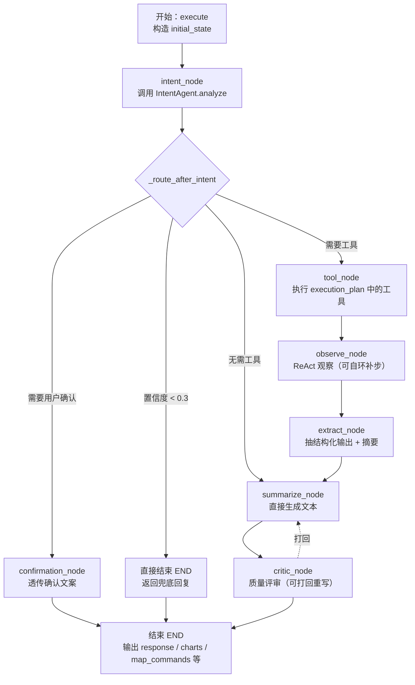
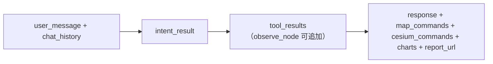
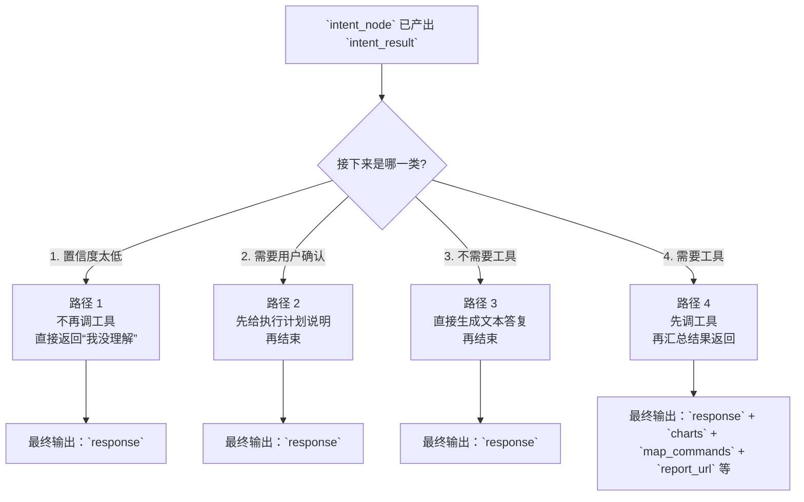
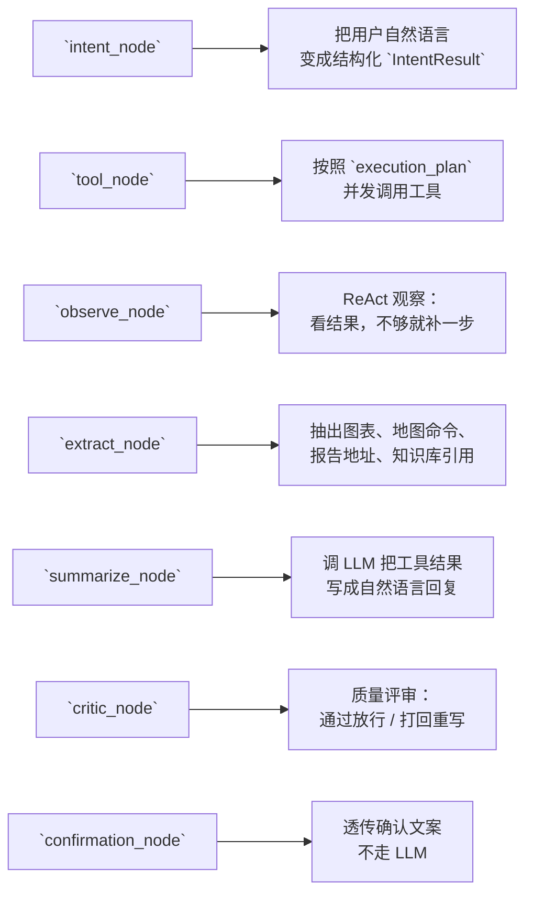

# `backend/agents` 中 LangGraph 节点与状态说明

> ⚠️ **文档版本说明（2026-09 P1 改造后修订）**：本文档主体编写于 P1 架构改造之前。当前架构已发生两点关键演进：
> 1. **图已从三节点（`intent → tool → response`）演进为七节点**：`intent → tool → observe(可自环) → extract → summarize ⇄ critic`，另有 `confirmation_node` 独立确认分支；
> 2. **流式链路已由 `RunEngine` 统一驱动**：`execute_stream()` 已不存在，SSE 端点在 `routers/chat.py` 中统一走 RunEngine（内部手动顺序调用节点函数，不走 LangGraph 图）。
>
> 阅读时请注意：§4 / §5 / §6 / §8 / §9 / §16 / §17 / §18.4 / §18.8 / §18.10 / §18.11 中涉及“三节点图 / `response_node` / `execute_stream`”的表述属于旧版描述（文中已就地修订或标注）。**最新架构的完整说明见 §19**，以及设计文档《ReAct子图与Critic评审设计方案.md》。

> 面向后续接手开发的实习生。本文重点解释：**这套 LangGraph 是怎么搭起来的、每个节点读写哪些状态、状态如何在节点之间流转、以及当前实现里有哪些容易误解的点。**

## 1. 先说结论

这套 Agent 架构里，**真正定义 LangGraph 的文件是 `task_executor.py`**，而不是 `intent_agent.py`。

- `intent_agent.py`：负责**意图识别 + 任务规划**，输出结构化的 `IntentResult`
- `task_executor.py`：负责**定义 LangGraph 图、执行节点、路由状态、汇总结果**
- `intent_types.py`：负责定义图里最核心的数据结构：`IntentType`、`TaskStep`、`IntentResult`

所以你可以把它理解成：

- `IntentAgent` = 图中的“意图分析引擎”
- `TaskExecutor` = 图的“编排器 / 调度器”
- `AgentState` = 图运行过程中的“共享状态仓库”

另外要注意：**只有当 `main.py` 里 `USE_INTENT_AGENT=true` 时，这套 LangGraph 才会真正接管 `/chat` 请求。**

---

## 2. 涉及到的关键文件

- `intent_agent.py`：结构化意图识别
- `task_executor.py`：LangGraph 主体
- `intent_types.py`：意图结果和执行计划的数据模型
- `main.py`：决定是否启用 LangGraph，并把 `/chat` 请求交给 `TaskExecutor.execute()`

---

## 3. 整体结构图

### 3.1 图的主流程

> ⚠️ 已按七节点图更新（旧版为 `intent → tool → response` 三节点）。



### 3.2 状态流转视角



你可以把整张图理解成一个“带两个受控回环”的流水线：

1. **先判断用户到底想干什么**
2. **如果要调用工具，就把计划里的工具跑一遍；结果不够时 `observe_node` 再补一步（受控自环）**
3. **抽取地图/图表/报告等结构化输出，整合成人话；高风险输出再经 `critic_node` 评审（受控回环，可打回重写一次）**

---

## 4. 图里有哪些节点

> ⚠️ **本节已按 P1 改造后的现状修订**（旧版描述为 3 个节点：`intent_node` / `tool_node` / `response_node`）。

在 `task_executor.py` 的 `_build_graph()` 里，LangGraph 当前注册了 **7 个节点**：

1. `intent_node`——意图识别 + 任务规划
2. `tool_node`——按 `execution_plan` 并发执行工具步骤
3. `observe_node`——图内 ReAct 观察（可自环，见 §19.2）
4. `extract_node`——抽取结构化输出（地图/图表/报告）+ 生成工具摘要
5. `summarize_node`——LLM 汇总生成自然语言回复
6. `critic_node`——质量评审（可打回 `summarize_node` 重生成，见 §19.3）
7. `confirmation_node`——确认路径专用节点（透传确认文案，不再经 LLM 覆写）

入口节点是：`intent_node`

边关系是：

- `intent_node` --条件路由--> `tool_node` / `summarize_node` / `confirmation_node` / `END`
- `tool_node` --> `observe_node`
- `observe_node` --条件路由--> `observe_node`（自环，本轮追加了步骤）/ `extract_node`（观察结束）
- `extract_node` --> `summarize_node`
- `summarize_node` --> `critic_node`
- `critic_node` --条件路由--> `summarize_node`（评审打回，携反馈重生成）/ `END`（通过或放行）
- `confirmation_node` --> `END`

换句话说，相比旧版“单入口、单出口、条件分流”的轻量图，现在多了**两个受控回环**：

- `observe_node` 的自环（ReAct 观察循环，上限 `REACT_MAX_ROUNDS`）
- `summarize_node ⇄ critic_node` 的评审回环（上限 `CRITIC_MAX_ROUNDS`）

---

## 5. 共享状态 `AgentState` 是什么

> ⚠️ **说明已更新**：状态定义已从 `task_executor.py` 机械搬移到 `agents/state.py`（`TypedDict`，类名仍为 `AgentState`）。P1 改造后新增了 5 个字段（见下表中带 ★ 的行）。

`agents/state.py` 里通过 `TypedDict` 定义了 LangGraph 的共享状态：

| 状态字段 | 类型 | 作用 | 主要由谁写入 |
| --- | --- | --- | --- |
| `user_message` | `str` | 当前用户输入 | `execute()` 初始化 |
| `chat_history` | `List[Dict]` | 历史对话，用于辅助意图识别 | `execute()` 初始化 |
| `intent_result` | `Optional[IntentResult]` | 结构化意图分析结果 | `intent_node` |
| `tool_results` | `List[Dict]` | 所有工具执行结果 | `tool_node` / `observe_node` |
| `tool_summaries` | `List[str]` | 工具结果摘要（extract → summarize 传递） | `extract_node` |
| `response` | `str` | 最终返回给前端的文本回答 | `summarize_node` 或路由阶段兜底 |
| `map_commands` | `List[Dict]` | 2D 地图命令 | `extract_node` |
| `cesium_commands` | `List[Dict]` | 3D 地图命令 | `extract_node` |
| `charts` | `List[Dict]` | 图表配置 | `extract_node` |
| `report_url` | `Optional[str]` | 报告下载地址 | `extract_node` |
| `kb_sources` | `List[Dict]` | 知识库溯源引用（结构化） | `extract_node` |
| `error` | `Optional[str]` | 预留错误字段，目前使用不多 | `execute()` 初始化 |
| ★ `react_rounds` | `int` | 图内 ReAct：已用观察轮数（覆盖语义） | `observe_node` |
| ★ `react_last_added` | `bool` | 图内 ReAct：最近一轮是否追加步骤（观察路由依据） | `observe_node` |
| ★ `_critic_feedback` | `Optional[str]` | 评审反馈：待消费的修正指令（summarize 生成后清空） | `critic_node` 写入 / `summarize_node` 消费清空 |
| ★ `_critic_issues` | `List[str]` | 评审问题清单（日志/埋点用） | `critic_node` |
| ★ `_critic_round` | `int` | 评审已用修正轮数（只增不减，防死循环） | `critic_node` |

其中这几个字段用了：

- `Annotated[List[Dict], operator.add]`

包括：

- `tool_results`
- `map_commands`
- `cesium_commands`
- `charts`

这表示 **LangGraph 在并行分支合并状态时，可以用 `operator.add` 追加列表**。不过要注意：**当前这份图并没有真正把 `tool_node` 拆成多个 LangGraph 并行节点**，而是在 `tool_node` 内部使用 `asyncio.gather()` 做并发。所以这里更像是“为后续扩展预留的状态合并能力”。

> ⚠️ **reducer 安全约定（新增）**：`tool_results` 是 `operator.add` 合并语义，所以 `observe_node` 返回时**只携带本轮新增的那一条结果**（部分更新），严禁返回全量列表（会翻倍）。新增节点返回部分更新或 `{}` 均可，LangGraph 按 reducer 合并。

---

## 6. 每个节点到底读什么、写什么

### 6.1 `intent_node`

**职责**：识别意图，生成执行计划。

**核心调用**：

- `self.intent_agent.analyze(state["user_message"], state.get("chat_history"))`

**输入状态**：

- `user_message`
- `chat_history`

**输出状态**：

- `intent_result`

**状态变化前后**：

| 阶段 | 关键状态 |
| --- | --- |
| 进入前 | `intent_result = None` |
| 离开后 | `intent_result = IntentResult(...)` |

`IntentAgent.analyze()` 最终会让大模型输出一个结构化对象 `IntentResult`，里面至少包括：

- `primary_intent`：主意图
- `confidence`：置信度
- `entities`：提取出的实体
- `task_context`：任务摘要
- `execution_plan`：后续要执行的步骤列表
- `requires_confirmation`：是否需要用户确认

所以 `intent_node` 的本质可以概括为：

> **把自然语言用户请求，翻译成机器可执行的结构化任务单。**

---

### 6.2 `_route_after_intent`（条件路由器）

严格来说它不是 `add_node()` 注册的节点，但它是这张图最重要的“分流器”。

它会根据 `intent_result` 决定下一步走向：

#### 情况 A：`intent_result is None`

- 直接 `END`

#### 情况 B：`confidence < 0.3`

- 写入兜底 `response`
- 清空 `map_commands / cesium_commands / charts / tool_results`
- 直接 `END`

#### 情况 C：`requires_confirmation = True`

- 先写入确认提示文本到 `response`
- 清空 `map_commands / cesium_commands / charts / tool_results`
- 跳到 `confirmation_node`（透传确认文案，不再被覆写）

#### 情况 D：不需要工具

- `tool_results = []`
- 跳到 `summarize_node`（跳过 tool/extract，直接生成文本）

#### 情况 E：需要工具

- 跳到 `tool_node`

可以把它理解成：

> **先看意图分析结果够不够靠谱，再决定是直接结束、先确认，还是继续跑工具。**

---

### 6.3 `tool_node`

**职责**：执行 `execution_plan` 里需要工具的步骤。

**输入状态**：

- `intent_result.execution_plan`

**输出状态**：

- `tool_results`

它的执行逻辑是：

1. 从 `execution_plan` 里筛出带 `tool` 的步骤
2. 为每个步骤找到对应的工具适配器 `QwenToolAdapter`
3. 用 `asyncio.gather()` 并发执行全部步骤
4. 把每一步的结果收集成列表，写入 `state["tool_results"]`

`tool_results` 中每一项大致长这样：

```python
{
  "tool_name": "postgresql_tool",
  "result": {
    "success": True,
    "content": "...",
    "map_command": {...},
    "chart_type": "line",
    "config": {...}
  }
}
```

这里要注意一个实现特点：

- **工具是并发执行的**，但并发发生在 `tool_node` 内部
- **LangGraph 图本身没有拆成多个工具子节点**

也就是说，目前的图拓扑仍然很简单；真正“并行”的是节点内部的 Python 代码。

---

### 6.4 `extract_node` + `summarize_node`（原 `response_node` 已拆分）

> ⚠️ **本节已按现状修订**：旧版的 `response_node` 被拆成了两个节点——`extract_node`（抽结构化结果）+ `summarize_node`（LLM 文本汇总），职责分离后再加上 `critic_node` 评审，链路为 `extract → summarize → critic`。

#### `extract_node`（文件：`agents/nodes/extract_node.py`）

**职责**：从 `tool_results` 中抽取结构化输出，并生成工具摘要。

**输入状态**：

- `intent_result`
- `tool_results`
- `user_message`

**输出状态**：

- `map_commands`
- `cesium_commands`
- `charts`
- `report_url`
- `kb_sources`
- `tool_summaries`（供 summarize 使用）

抽取规则（与旧版一致）：

- `map_command` -> 收集到 `map_commands`
- `cesium_command` -> 收集到 `cesium_commands`
- `data_visualizer_tool` 的图表配置 -> 收集到 `charts`
- `report_generator_tool` 的下载地址 -> 写入 `report_url`

#### `summarize_node`（文件：`agents/nodes/summarize_node.py`）

**职责**：把每个工具的 `content / message / error` 摘要后，调用一次 LLM 做自然语言总结，写入 `response`。

**P1 改造要点（评审反馈注入）**：

1. **短路**：若 `response` 已有值且 `_critic_feedback` 为空，直接返回（避免重复生成）；
2. **反馈注入**：若 `_critic_feedback` 有值，`rich_content` 透传禁用，并在 prompt 中追加“上一版回答存在以下问题：{feedback}”，要求重输出完整回答；
3. **反馈消费**：生成完成后**必须清空 `_critic_feedback`**（否则 `critic_node` 路由会再次打回，导致死循环）。

所以 `extract + summarize + critic` 的本质是：

> **把工具层产生的结构化结果和文字摘要打包成最终输出对象，再经质量评审确认或打回重写。**

---

## 7. `IntentResult` 为什么是整个图的核心状态

在这套实现里，`IntentResult` 基本决定了后续所有分支：

| 字段 | 作用 |
| --- | --- |
| `primary_intent` | 决定回答风格，也影响后续规划 |
| `confidence` | 决定是否直接拒答/兜底 |
| `entities` | 保存实体抽取结果 |
| `task_context` | 对当前任务的摘要说明 |
| `execution_plan` | 决定要不要调用工具、调用哪些工具 |
| `requires_confirmation` | 决定是否需要先向用户确认 |
| `suggestions` | 无法理解时给用户的补充建议 |

因此，很多同学第一次看代码会误以为：

- `intent_agent.py` 只是“分类器”

其实不止。它做的是：

- **分类** + **实体抽取** + **任务规划**

这就是为什么 `intent_node` 的输出足以驱动整个 LangGraph 后半段。

---

## 8. 4 条最常见的状态流转路径

### 8.1 正常路径：识别成功 + 需要工具

例如用户说：

> “统计最近一月采砂量趋势，并生成折线图。”

状态流转大致是：

1. `execute()` 初始化：
   - `user_message` 有值
   - `intent_result = None`
   - `tool_results = []`
   - `charts = []`
2. `intent_node`：
   - 识别出 `data_visualization`
   - 生成 `execution_plan`
3. `_route_after_intent`：
   - 置信度高
   - 不需要确认
   - 需要工具
   - 跳到 `tool_node`
4. `tool_node`：
   - 调用 `postgresql_tool`
   - 调用 `data_visualizer_tool`
   - 得到 `tool_results`
5. `extract_node`：
   - 从结果中抽出 `charts`
6. `summarize_node`：
   - 生成文字说明 `response`（之后经 `critic_node` 评审放行）
7. `END`：
   - 前端拿到 `response + charts`

---

### 8.2 低置信度路径：识别失败

例如用户输入非常模糊，模型无法可靠分类。

状态变化：

1. `intent_node` 仍会产出 `intent_result`
2. `_route_after_intent` 发现 `confidence < 0.3`
3. 写入兜底回复：
   - `response = 抱歉，我无法理解您的意图...`
4. 清空：
   - `tool_results = []`
   - `map_commands = []`
   - `cesium_commands = []`
   - `charts = []`
5. 直接 `END`

这条路径**不会进入 `tool_node`**，因为系统认为继续执行风险太高。

---

### 8.3 需要确认路径：先问用户要不要执行

当 `IntentAgent` 判断任务需要确认时：

1. `_route_after_intent` 先生成确认文案（写入 `response`）
2. 清空所有结构化输出
3. 跳转到 **`confirmation_node`**
4. `confirmation_node` 透传确认文案，直接 `END`

从设计意图看，这条路径是：

> **先告诉用户“我理解你要做什么，我准备怎么做，请确认一下”。**

### 历史细节（已修复）

旧实现中，确认路径跳到 `response_node`，导致 `_route_after_intent()` 写入的确认文案被 `response_node` 重新生成的 `response` 覆盖。

**P1 前已修复**：新增独立节点 `confirmation_node`（定义在 `agents/nodes/serialize.py` 的 `OutputSerializationMixin` 中），只透传 `_route_after_intent` 写入的确认文案，不走 `summarize_node`，直接 `confirmation_node → END`。

---

### 8.4 不需要工具路径：直接生成文字答复

如果 `execution_plan` 里没有任何工具：

1. `_route_after_intent` 设定 `tool_results = []`
2. 跳到 **`summarize_node`**
3. `summarize_node` 发现没有工具摘要
4. 生成轻量文本回复

这条路径适合一些非常轻量的意图解释或无需查库/上图的请求。

---

## 9. 一个更适合实习生记忆的“节点状态表”

> ⚠️ **已按七节点图重制**。

| 节点 / 阶段 | 进入时重点状态 | 离开时新增/修改状态 | 你可以怎么理解 |
| --- | --- | --- | --- |
| `execute()` | 用户输入、历史消息 | 初始化整份 `AgentState` | 开局装配上下文 |
| `intent_node` | `user_message`, `chat_history` | `intent_result` | 把自然语言翻译成任务单 |
| `_route_after_intent` | `intent_result` | 决定下一个节点，并可能提前写 `response` | 图的交通指挥员 |
| `tool_node` | `intent_result.execution_plan` | `tool_results` | 按计划真正干活 |
| `observe_node` | `tool_results`, `react_rounds` | `tool_results`（追加单条）、`react_rounds`, `react_last_added` | 看一眼结果，还缺就补一步 |
| `extract_node` | `tool_results` | `map_commands`, `charts`, `report_url`, `kb_sources`, `tool_summaries` 等 | 抽取结构化输出 + 生成摘要 |
| `summarize_node` | `tool_summaries`, `_critic_feedback` | `response`（并消费清空 `_critic_feedback`） | 把工具结果写成自然语言回复 |
| `critic_node` | `response`, `intent_result`, `tool_results`, `_critic_round` | 打回时：清空 `response`、写 `_critic_feedback` / `_critic_issues`、`_critic_round`+1 | 质量评审：通过放行 / 打回重写 |
| `confirmation_node` | `response`（确认文案） | 不变（透传） | 确认路径专用，不再被覆写 |
| `END` | 完整最终状态 | 返回给调用方 | 本轮图执行结束 |

---

## 10. `intent_agent.py` 在图里扮演什么角色

这个文件里没有 `StateGraph`、没有 `add_node()`、也没有 `add_edge()`。

所以它**不是图定义文件**。

但它在 `intent_node` 中被直接调用，是整张图最关键的“上游分析器”。它的工作流程是：

1. 构造系统提示词（定义意图体系、工具映射、业务规则）
2. 拼接最近几轮对话上下文
3. 调用结构化输出 LLM：`llm.with_structured_output(IntentResult)`
4. 拿到一个标准化的 `IntentResult`

因此更准确的表述应该是：

> `intent_agent.py` 不是节点定义文件，但它承载了 `intent_node` 的核心计算逻辑。

---

## 11. `main.py` 和 LangGraph 的关系

很多人看 `agents/` 目录时会遗漏一个事实：

- **图的定义在 `agents/`**
- **图的实际启用入口在 `main.py`**

在 `/chat` 接口里，后端会先判断：

- 环境变量 `USE_INTENT_AGENT` 是否为 `true`

如果是，才会：

- 调用 `task_executor.execute(...)`

否则就还是走旧的 `bot` 路径。

所以如果你发现自己改了 LangGraph 代码，但接口行为没变化，第一件事要排查的不是节点逻辑，而是：

> **当前服务到底有没有真的走到 `TaskExecutor`。**

---

## 12. 这套实现里最容易踩坑的 6 个点

### 12.1 `intent_agent.py` 不是图定义文件

新同学最容易误判这里“是不是 LangGraph 主体”。答案是：**不是**。

---

### 12.2 `tool_results` 虽然声明了可合并，但目前不是 LangGraph 多节点并行

现在的并发发生在：

- `tool_node` 内部的 `asyncio.gather()`

而不是：

- LangGraph 图里拆出多个并行工具节点

所以不要把现在的实现误解成“图级并行 DAG”。

---

### 12.3 `requires_confirmation` 路径曾有回复被覆盖风险（已修复）

旧实现中确认文案会被 `response_node` 覆盖；现已由独立节点 `confirmation_node` 修复（见 §8.3）。

---

### 12.4 `MemorySaver` 存在，但图状态的业务连续性仍主要依赖传入的 `chat_history`

虽然 `TaskExecutor` 用了：

- `MemorySaver`
- `thread_id`

但当前每次 `execute()` 仍然会重新构造一份 `initial_state`，并显式传入：

- `user_message`
- `chat_history`

因此从业务视角看，**会话连续性主要还是靠外部请求把历史消息带进来**，而不是完全依赖 LangGraph 内部状态滚动累积。

---

### 12.5 LangGraph 模式下返回值里 `messages` 是空列表

`execute()` 返回时写死了：

- `"messages": []`

这意味着前端如果还沿用旧的“从 `messages` 里读工具消息”的思路，就可能需要额外适配 `charts / map_commands / cesium_commands` 这些独立字段。

---

### 12.6 `response_node` 曾“抽结构化结果 + 写自然语言回复”职责二合一（已拆分）

旧版的 `response_node` 职责较重。现已拆分为：

- `extract_node`：只负责抽结构化结果（`map_commands` / `charts` / `report_url` / `kb_sources`）+ 生成 `tool_summaries`
- `summarize_node`：只负责 LLM 文本汇总（写 `response`，并消费 `_critic_feedback`）

后面如果继续加输出类型，只需扩展 `extract_node`，不会再触碰文本生成逻辑。

---

## 13. 给后续开发的建议（旧建议的落地情况）

> ⚠️ **本节已更新**：以下建议中的 13.1 / 13.3 已在 P1 改造中落地。

### 13.1 把确认分支从 `response_node` 中剥离 ✅ 已实施

已新增 `confirmation_node`，确认文案不再被覆写（见 §8.3）。

### 13.2 真正把工具调用升级成图级并行分支（未实施）

当前仍是 `tool_node` 内部并发。后面如果需要更清晰的可观测性，可以拆成：

- `db_query_node`
- `visualize_node`
- `report_node`

然后通过 LangGraph 的合并能力汇总状态。（注：目前 `tool_results` 的 `operator.add` 合并能力已被 `observe_node` 自环追加单条结果使用。）

### 13.3 给 `AgentState` 增加更明确的中间字段 ✅ 部分实施

已增加：

- `tool_summaries`（extract → summarize 传递）
- `react_rounds` / `react_last_added`（图内 ReAct 轮数与路由依据）
- `_critic_feedback` / `_critic_issues` / `_critic_round`（评审反馈闭环）

尚未实施：`selected_tools` / `confirmation_message` / `final_payload`。

---

## 14. 一句话总结

> **这套 LangGraph 的核心流程是：`intent_node` 先把用户需求转成 `IntentResult`，`tool_node` 按 `execution_plan` 干活，`observe_node` 按需补步（ReAct），`extract_node` 抽出结构化输出，`summarize_node` 写成自然语言回复，`critic_node` 做质量评审（可打回重写一次）。**

而 `intent_agent.py` 并不是图本身，它是 `intent_node` 背后的“分析引擎”。

---

## 15. 建议你阅读源码的顺序

对于第一次接手这块代码的人，推荐阅读顺序是：

1. `intent_types.py` —— 先弄清 `IntentResult` 长什么样
2. `intent_agent.py` —— 理解这个结构化结果是怎么来的
3. `task_executor.py` —— 理解 LangGraph 如何消费这些状态
4. `main.py` —— 理解请求什么时候会进入 LangGraph

按这个顺序看，最不容易迷路。

---

## 16. 一眼看懂版逻辑图

上面已经把细节解释清楚了；如果你觉得前面的图太“工程化”，那这一节就只保留 **最值得先看懂的 4 张图**。建议把这 4 张图当成“地图”，再回头看源码。

### 16.1 总览图：一次请求到底怎么走

先只看这一张，就能知道整个系统的主干流程。

```mermaid
flowchart LR
    A[1. 前端发起 /chat 请求] --> B[2. `routers/chat.py` 的 `chat()` 接口]
    B --> C{3. 是否启用 `USE_INTENT_AGENT`?}
    C -->|否| X[走旧版 bot 链路]
    C -->|是| D[4. `TaskExecutor.execute()`]

    subgraph G1[LangGraph 主流程（七节点）]
        D --> E[5. `intent_node`\n识别意图 + 生成任务计划]
        E --> F{6. 路由判断}
        F -->|低置信度| G[直接结束\n返回兜底回复]
        F -->|需要确认| H[进入 `confirmation_node`\n透传确认文案]
        F -->|无需工具| S[进入 `summarize_node`\n直接生成文本]
        F -->|需要工具| I[进入 `tool_node`\n并发调用工具]
        I --> O[进入 `observe_node`\nReAct 观察（可自环补步）]
        O --> X1[进入 `extract_node`\n抽结构化输出 + 摘要]
        X1 --> S
        S --> CRT[进入 `critic_node`\n质量评审（可打回重写）]
        CRT -.打回.-> S
        H --> K[END]
        G --> K
        CRT --> K
    end
```

### 16.2 四条典型路径图：系统最后只会走这 4 种结果

读代码时最容易迷路的地方，其实不是节点本身，而是不知道“最后会落到哪种情况”。这张图专门解决这个问题。



### 16.3 状态仓库图：每个节点往哪里写数据

把 `AgentState` 想成一个“共享仓库”就好。每个节点只是往仓库里放东西、再从仓库里取东西。

```mermaid
flowchart TB
    subgraph S[共享状态 `AgentState`]
        U[`user_message`]
        H[`chat_history`]
        I[`intent_result`]
        T[`tool_results`]
        TS[`tool_summaries`]
        R[`response`]
        M[`map_commands`]
        C[`cesium_commands`]
        CH[`charts`]
        P[`report_url`]
        KS[`kb_sources`]
        RR[`react_rounds` / `react_last_added`]
        CF[`_critic_feedback` / `_critic_issues` / `_critic_round`]
    end

    N1[`intent_node`] -->|读取| U
    N1 -->|读取| H
    N1 -->|写入| I

    N2[`tool_node`] -->|读取| I
    N2 -->|写入| T

    N4[`observe_node`] -->|读取| T
    N4 -->|写入单条| T
    N4 -->|写入| RR

    N3[`extract_node`] -->|读取| T
    N3 -->|写入| M
    N3 -->|写入| C
    N3 -->|写入| CH
    N3 -->|写入| P
    N3 -->|写入| KS
    N3 -->|写入| TS

    N5[`summarize_node`] -->|读取| TS
    N5 -->|读取/清空| CF
    N5 -->|写入| R

    N6[`critic_node`] -->|读取| R
    N6 -->|打回时写入| CF
    N6 -->|打回时清空| R
```



### 16.4 节点职责图：每个节点只做什么事

如果你不想先管状态字段，只想知道“每个节点负责什么”，那就看这一张。



### 16.5 历史风险图（已修复）

这一张图记录旧版的一个设计风险：**确认分支的文案可能被 `response_node` 改写**。现已由 `confirmation_node` 修复。

```mermaid
flowchart LR
    A[`_route_after_intent()`\n写入确认文案] --> B[`confirmation_node`\n透传，不改写]
    B --> C[最终返回给前端\n就是原始确认文案]
```

### 16.6 最推荐的阅读顺序

如果是第一次接手，建议按下面这个顺序看：

1. **先看 `16.1`**：知道整条链路从哪里进、到哪里出
2. **再看 `16.2`**：知道系统最终只有 4 种路径
3. **再看 `16.3`**：知道每个节点往共享状态里写什么
4. **最后看 §19**：了解两个受控回环（observe 自环 / critic 评审回环）的完整机制

如果看完这几张图还是觉得抽象，再回到前面的详细文字说明，就会顺很多。

---

## 17. 流式链路与 LangGraph 图的关系——最容易误解的一个设计

> ⚠️ **本节已整体重写**：旧版描述的是 `TaskExecutor.execute_stream()` 手写生成器，该实现已被 P1 收敛移除；流式链路现由 **`agents/run_engine.py` 的 `RunEngine`** 统一驱动（`routers/chat.py` 收敛为单驱动，RunEngine 不可用时才回退 legacy bot）。

### 17.1 问题：流式接口到底走不走 LangGraph 图？

后端有两个对外入口：

| 入口 | 调用者 | 走不走 `self._graph`？ |
|------|--------|----------------------|
| `/chat`（非流式） | `routers/chat.py` → `TaskExecutor.execute()` | ✅ 走，调用 `self._graph.ainvoke()` |
| `/chat/stream`（SSE） | `routers/chat.py` → `RunEngine.start()` | ❌ 不走图，RunEngine 手动顺序调用节点函数 |

**结论：前端看到的所有流式状态卡片由 `RunEngine` 驱动（事件经 EventBus 落 RunStore，再由 SSE 端点转发），与 LangGraph 图的调度逻辑无关；但两者共享同一套节点函数（`_intent_node` / `_tool_node` / `_observe_node` / `_extract_node` / `_summarize_node` / `_critic_node`）与协同组件（ReActObserver / ResponseCritic），只是调度方式不同。**

---

### 17.2 为什么流式链路不直接用 LangGraph 的 `.astream()`？

LangGraph 原生的 `.astream()` / `.ainvoke()` 只能在**节点完成后**才能拿到该节点的输出，粒度是"节点级"的。

但流式链路需要的控制力更强：
- 进度粒度更细：意图识别**开始时**推卡片、每个工具**开始/完成**各推一次、评审**开始/打回/完成**各推一次；
- run 可中断 / 可恢复（确认、补参）/ 可取消，且**断线不影响后台执行**（run 在独立 asyncio task 中运行，事件落 RunStore，重连按 `seq` 补拉）。

LangGraph 的节点是黑盒，无法在节点内部埋细粒度事件。所以 `RunEngine` 选择**不经过 `self._graph`**，改为手动顺序调用节点函数，并在每个关键时间点 `_emit()` 事件。

---

### 17.3 RunEngine 的执行顺序（主路径概览）

```
RunEngine.start(run_id, ...)
│
├─ emit status(intent)              # 意图分析开始
├─ 调用 _intent_node(state)         # 意图分析完成，附带 intent_result
│
├─ 直答分支（部分无需工具的简单场景）→ 生成回复 → emit final
│
├─ 主路径（完整链路）：
│   ├─ 逐步骤/并行执行工具（asyncio.as_completed 顺序）
│   │   ├─ emit tool_start          # 每个工具开始
│   │   └─ emit tool_result         # 每个工具完成
│   ├─ ReAct 观察（_react_observe → 共享 ReActObserver）
│   ├─ 调用 _extract_node(state)
│   ├─ 调用 _summarize_node(state)
│   ├─ _critic_review_stream(run_id, state, intent_result)   # P1：质量评审
│   │   ├─ emit status(critic)          # 评审开始
│   │   ├─ 打回 → emit status(critic_revise) → 携反馈重生成 → emit status(critic_done)
│   │   └─ 通过/降级 → emit status(critic_done)
│   └─ workspace.record 等收尾
│
└─ emit final(result)               # 最终结果，包含 response/charts/map_commands 等
```

---

### 17.4 `self._graph` 什么时候被用到？

`self._graph` 在 `__init__` 里编译好，绑定了 `MemorySaver` 做会话记忆。  
非流式 `/chat` 端点调用 `TaskExecutor.execute()` 时，走 `self._graph.ainvoke()`，七节点图（含 observe 自环与 critic 回环）完整生效。

流式 `/chat/stream` 端点则完全走 `RunEngine`，`self._graph` 不参与。

---

### 17.5 SSE 事件如何从后端到前端状态卡片

```
run_engine.py                      routers/chat.py                 前端
RunEngine._emit()                  /chat/stream                    SSE EventSource
    │                                  │                               │
    ├─ EventBus.publish()  ──► RunStore（seq 严格递增）                 │
    │                                  │                               │
    │                     event_generator():                          │
    │                     queue = await bus.subscribe(run_id)         │
    │                     queue.get() → SSE data 帧  ──────────────►│ pushStreamProgress()
    │                                  │                               │
    └─ final 事件          ──► SSE data 帧            ──────────────►│ finalResult = event.result
                                       │                               │ setMessages(...) 渲染最终回复
```

前端对每个收到的非 `final` 事件：
1. 调 `activateRealProgress()`：清除 fallback 占位卡片
2. 调 `pushStreamProgress()`：追加真实进度卡片
3. `queued` / `start` 阶段事件被过滤，不渲染卡片

---

### 17.6 一句话总结

> **`self._graph` 定义了"图长什么样"（非流式链路直接执行七节点图），`RunEngine` 定义了"流式接口怎么跑"（手动顺序调用节点 + 细粒度事件）。两者共享同一套节点函数与协同组件（ReActObserver / ResponseCritic），但调度方式完全不同。**

---

## 18. 本项目用到了哪些 LangGraph / LangChain 技术——科普篇

> 面向没有接触过 LangGraph 的读者。本章解释"这些技术是什么、为什么存在、在本项目里怎么用的"。

---

### 18.1 LangGraph 是什么？

LangGraph 是 LangChain 团队推出的 **有状态多节点工作流框架**，专为 LLM 应用设计。

你可以把它理解成：

```
普通代码：if/else + 函数调用 = 写死的顺序
LangGraph：节点 + 边 + 共享状态 = 可以动态路由的图
```

它解决的核心问题：**LLM 应用经常需要"根据 LLM 输出决定下一步做什么"，普通代码很难优雅地表达这种动态分支。**

---

### 18.2 技术 1：`StateGraph` + `TypedDict` 状态定义

**是什么**：LangGraph 的图容器。所有节点共享一个 `State` 字典，节点读取、修改这个字典，图负责在节点之间传递它。

**本项目用法**（`task_executor.py`）：

```python
from langgraph.graph import StateGraph, END

class AgentState(TypedDict):
    user_message: str
    intent_result: Optional[IntentResult]
    tool_results: Annotated[List[Dict], operator.add]  # 见 18.3
    response: str
    map_commands: Annotated[List[Dict], operator.add]
    ...

graph = StateGraph(AgentState)
```

**为什么用 TypedDict 而不是普通 dict**：TypedDict 提供类型提示，IDE 可以自动补全字段名，减少手误。LangGraph 在运行时也会用它做状态校验。

---

### 18.3 技术 2：`Annotated[List, operator.add]` —— 状态合并器

**是什么**：告诉 LangGraph，当多个节点同时向同一个字段写入数据时，应该用 `operator.add`（即列表拼接）而不是覆盖。

**本项目用法**：

```python
tool_results: Annotated[List[Dict], operator.add]
map_commands: Annotated[List[Dict], operator.add]
```

**为什么需要它**：`_tool_node` 并发执行多个工具，每个工具的结果都要追加到 `tool_results`，而不是互相覆盖。没有这个注解，后写的会把先写的冲掉。

**对比**：

```
没有 Annotated：node_A 写 [结果1]，node_B 写 [结果2] → 最终只有 [结果2]
有 Annotated：  node_A 写 [结果1]，node_B 写 [结果2] → 最终是 [结果1, 结果2]
```

---

### 18.4 技术 3：`add_node` / `add_edge` / `add_conditional_edges`

**是什么**：图的结构定义 API。

| API | 作用 |
|-----|------|
| `graph.add_node("名字", 函数)` | 注册一个节点，绑定执行函数 |
| `graph.add_edge("A", "B")` | A 完成后必定进入 B（固定边） |
| `graph.add_conditional_edges("A", 路由函数, 映射表)` | A 完成后，由路由函数的返回值决定进哪个节点（动态边） |
| `graph.set_entry_point("A")` | 指定入口节点 |

**本项目用法**：

```python
graph.set_entry_point("intent_node")
graph.add_conditional_edges(
    "intent_node",
    self._route_after_intent,   # 路由函数：返回 "tool_node" / "summarize_node" / "confirmation_node" / END
    {
        "tool_node": "tool_node",
        "summarize_node": "summarize_node",
        "confirmation_node": "confirmation_node",
        END: END,
    },
)
graph.add_edge("tool_node", "observe_node")      # 工具执行完，进入 ReAct 观察
graph.add_edge("extract_node", "summarize_node")
graph.add_edge("summarize_node", "critic_node")  # 生成后进入质量评审
graph.add_conditional_edges(                      # 条件回环：评审打回 → 重生成
    "critic_node",
    self._route_after_critic,
    {"summarize_node": "summarize_node", END: END},
)
```

`_route_after_intent` 就是那个“看 LLM 输出，决定往哪走”的函数：

```python
def _route_after_intent(self, state):
    if intent_result.confidence < 0.3:
        return END                    # 置信度太低，直接结束
    if intent_result.requires_confirmation:
        return "confirmation_node"    # 需要确认，跳过工具
    if not required_tools:
        return "summarize_node"       # 无工具，直接回答
    return "tool_node"                # 正常路径，先调工具
```

而 `_route_after_critic` 是评审回环的“闸门”：

```python
def _route_after_critic(self, state):
    if state.get("_critic_feedback"):   # 打回：携反馈回到 summarize 重生成
        return "summarize_node"
    return END                          # 通过或放行，结束
```

---

### 18.5 技术 4：`MemorySaver` —— 进程内会话记忆

**是什么**：LangGraph 内置的检查点（Checkpointer）实现，把每次图运行的状态保存在内存里。下次同一个 `thread_id` 的请求进来，可以恢复上次的状态，实现多轮对话记忆。

**本项目用法**：

```python
from langgraph.checkpoint.memory import MemorySaver

self._memory = MemorySaver()
self._graph = graph.compile(checkpointer=self._memory)

# 调用时传 thread_id，同一会话复用同一份记忆
config = {"configurable": {"thread_id": thread_id}}
final_state = await self._graph.ainvoke(initial_state, config=config)
```

**注意**：MemorySaver 是进程内内存，重启服务后记忆清空。生产环境多实例部署需要换成 `SqliteSaver` 或 `PostgresSaver`。

---

### 18.6 技术 5：`graph.compile()` —— 图的编译

**是什么**：把定义好的图（节点 + 边 + 路由）"编译"成一个可执行对象，同时绑定检查点存储。

```python
self._graph = graph.compile(checkpointer=self._memory)
```

编译后的对象提供：
- `await self._graph.ainvoke(state, config)` — 异步执行，返回最终状态
- `self._graph.astream(state, config)` — 异步流式执行，按节点 yield 状态快照

---

### 18.7 技术 6：`with_structured_output(Pydantic模型)` —— LLM 结构化输出

**是什么**：LangChain 提供的能力，让 LLM 直接输出一个符合 Pydantic 模型定义的 JSON 对象，而不是自由文本。底层会把 Pydantic Schema 注入到 LLM 的 function calling / tool use 参数中。

**本项目用法**（`intent_agent.py`）：

```python
from langchain_openai import ChatOpenAI

llm = ChatOpenAI(model="qwen-plus", ...)
self.structured_llm = llm.with_structured_output(IntentResult)

# 调用时直接返回 IntentResult 实例，不是字符串
result: IntentResult = self.structured_llm.invoke(messages)
```

**IntentResult 是什么**（`intent_types.py`）：

```python
class IntentResult(BaseModel):
    primary_intent: IntentType      # 枚举：map_display / data_query / ...
    confidence: float               # 0.0 ~ 1.0
    entities: List[str]             # 提取的实体
    task_context: str               # 任务摘要
    execution_plan: List[TaskStep]  # 每一步用什么工具、传什么参数
    requires_confirmation: bool
    suggestions: List[str]
```

**为什么不直接让 LLM 返回文本再解析**：结构化输出避免了 JSON 解析失败、字段缺失、格式不稳定等问题，LangChain 会自动重试校验，直到输出符合 Schema 为止。

---

### 18.8 技术 7：`asyncio.gather` + `asyncio.as_completed` —— 工具并发

**是什么**：Python 标准库的异步并发原语，不是 LangGraph 的功能，但在本项目的工具执行层被大量使用。

| 函数 | 行为 |
|------|------|
| `asyncio.gather(*tasks)` | 并发启动所有任务，等全部完成，按**提交顺序**返回结果 |
| `asyncio.as_completed(tasks)` | 并发启动，按**完成顺序**返回结果（谁先完成谁先 yield） |

**本项目用法**：
- `_tool_node`（非流式图）：用 `asyncio.gather`，一次性拿到所有工具结果
- `RunEngine`（流式执行引擎）：用 `asyncio.as_completed`，每个工具完成后立刻 `_emit("tool_result", ...)` 事件（事件先落 RunStore，再由 SSE 端点订阅推送）

```python
# 流式版：工具完成一个，立刻推一个进度卡片（run_engine.py 简化示意）
for finished in asyncio.as_completed(list(pending_tasks.values())):
    step_id, result = await finished
    await self._emit(run_id, "tool_result", ...)   # 立刻推送
```

**为什么这么做**：用户发出请求后，如果有 3 个工具要并发执行，不用等全部完成才看到进度，而是每完成一个就能看到一张进度卡片，体验更好。

---

### 18.9 技术 8：`loop.run_in_executor` —— 同步工具的异步化

**是什么**：把一个**同步阻塞函数**放到线程池里执行，让 asyncio 事件循环不被阻塞。

**本项目用法**：各工具（`MapTool`、`PostgreSQLTool` 等）的 `.call()` 方法都是同步的（涉及数据库 IO、网络请求），在异步上下文里直接调用会阻塞事件循环，导致其他请求卡住。

```python
loop = asyncio.get_event_loop()
result = await loop.run_in_executor(None, adapter.invoke, params)
#                              ^^^^  None = 用默认线程池
```

---

### 18.10 技术 9：`AsyncGenerator` —— 异步生成器（流式的核心）

**是什么**：Python 的 `async def` 函数里使用 `yield` 就成了异步生成器，调用者用 `async for` 遍历，每次 `yield` 推送一个值。

**本项目用法**：当前 SSE 主链路已不再用“手写生成器直连节点”的方式（旧版 `execute_stream()` 已移除），而是：

1. `RunEngine.start()` 在独立 asyncio task 中执行 run，通过 `EventBus` 把每个阶段事件写入 `RunStore`（带严格递增 `seq`）；
2. `routers/chat.py` 的 SSE 端点在 `event_generator()` 里订阅 `EventBus`，把事件逐条序列化为 SSE `data:` 帧推给前端（断线后可按 `seq` 补拉）。

```python
# routers/chat.py（简化示意）
queue = await bus.subscribe(run_id)      # 订阅事件
while True:
    event = await queue.get()
    yield f"data: {json.dumps(event)}\n\n"   # SSE 格式
```

因此 `AsyncGenerator` 依然是流式输出的核心形态（SSE 端点本身就是一个异步生成器），只是事件源从“手写编排的 `execute_stream()`”换成了“**RunEngine + EventBus**”。

---

### 18.11 技术汇总表

| 技术 | 来源 | 本项目用途 |
|------|------|-----------|
| `StateGraph` | LangGraph | 定义七节点图（含 observe 自环与 critic 评审回环）的结构和路由 |
| `TypedDict` + `Annotated` | Python / LangGraph | 共享状态定义 + 列表自动合并 |
| `add_conditional_edges` | LangGraph | `intent_node` 分流、`observe_node` 自环、`critic_node` 回环三处动态路由 |
| `MemorySaver` | LangGraph | 进程内多轮对话记忆 |
| `graph.compile()` | LangGraph | 编译图，绑定检查点 |
| `with_structured_output` | LangChain | 意图识别直接输出 `IntentResult` Pydantic 对象 |
| `ChatOpenAI` | LangChain | 统一调用 Qwen 模型（兼容 OpenAI API） |
| `SystemMessage` / `HumanMessage` | LangChain | 构造 LLM 输入消息 |
| `asyncio.gather` | Python 标准库 | 非流式图内并发调用工具 |
| `asyncio.as_completed` | Python 标准库 | RunEngine 按完成顺序推进度事件 |
| `run_in_executor` | Python 标准库 | 同步工具/评审调用的异步化，不阻塞事件循环 |
| `AsyncGenerator` / `yield` | Python 标准库 | SSE 端点订阅 EventBus 的输出形态 |
| `Pydantic BaseModel` | Pydantic | `IntentResult` / `TaskStep` 数据校验 |
| `str Enum` | Python 标准库 | `IntentType` 枚举，值即字符串，JSON 序列化友好 |

---

## 19. P1 架构演进（2026-09）——两个受控回环

> 本节是全文的“最新真相”汇总。P1 改造把两个原本只存在于流式路径的智能能力（ReAct 观察、质量评审），以“领域无关组件”的形式同时接入了非流式图与流式 RunEngine，并给两者都加上了受控回环。

### 19.1 全景：共享组件 + 双执行路径

| 协同组件 | 文件 | 图路径（/chat） | 流式路径（/chat/stream） |
| --- | --- | --- | --- |
| ReAct 观察器 | `agents/react_loop.py`（`ReActObserver`） | `observe_node`（自环） | `RunEngine._react_observe`（薄包装） |
| 质量评审器 | `agents/critic.py`（`ResponseCritic`） | `critic_node`（回环） | `RunEngine._critic_review_stream` |
| 单步执行内核 | `tool_node.py` 的 `_invoke_single_step` | `observe_node` 复用 | RunEngine 复用（A 档 A-1 收敛） |

设计文档：《ReAct子图与Critic评审设计方案.md》（§3-§4 设计与§5 Critic，§9 实施记录）。

### 19.2 图内 ReAct 观察循环（observe_node）

**做什么**：工具结果出来后再“多看一眼”——信息不够时，由 LLM 决策追加**一步**只读工具调用，带新结果继续观察，直到 finish 或达到轮数上限。

**关键机制**：

1. **为何自环而不回 `tool_node`**：`tool_node` 每次进入都会重跑全量计划（无幂等保护）；`observe_node` 只执行“自己追加的单步”，用 `observe_node → observe_node` 自环推进；
2. **领域白名单动态化**：`领域 Agent tool_names ∩ DEFAULT_READONLY_TOOLS`（知识库/数据库/联网搜索三只读工具），交集为空直接 finish——地图类等意图零额外开销；
3. **轮数控制**：`react_rounds` 计数，达到 `REACT_MAX_ROUNDS` 即停；
4. **路由依据**：`react_last_added`——本轮追加了步骤 → 自环再来一轮；否则 → `extract_node`；
5. **reducer 安全**：只返回新增的单条结果（`operator.add` 合并），严禁全量返回；
6. **降级**：LLM 异常 / JSON 坏 / 工具不在白名单 → finish，主流程不受影响。

**环境变量**：`REACT_LOOP_ENABLED`（默认 1）、`REACT_MAX_ROUNDS`（默认 3）、`REACT_OBSERVE_MODEL`（默认 qwen-flash）。

### 19.3 图内 Critic 评审闭环（critic_node + summarize 改造）

**做什么**：回复生成后，由 LLM 按四维度（事实一致性 / 来源标注 / 完整性 / 无过度承诺）做质量评审；不通过则携反馈打回 `summarize_node` 重生成。

**触发条件（确定性，不命中则零额外开销）**：

- `CRITIC_ENABLED=1`；
- 响应非空且不超过 `CRITIC_MAX_RESPONSE_CHARS`（默认 6000）；
- 且满足其一：意图 ∈ {报告生成、知识搜索}，或 工具 ∈ {报告生成/采砂报告/知识库}，且工具执行成功。

**反馈闭环**：

```
summarize_node（生成回复）→ critic_node（评审）
  ├─ 通过 / 未命中触发 / 打回无 feedback → 放行 → END
  └─ 打回 → 清空 response + 写入 _critic_feedback → summarize_node 携反馈重生成 → END
```

**循环安全（三层保护，防死循环）**：

1. **入口守卫**：`_critic_round > CRITIC_MAX_ROUNDS` 直接放行；
2. **打回前配额检查**：`_critic_round + 1 > CRITIC_MAX_ROUNDS` 时不再打回（保守放行，保留最新版）；
3. **反馈消费**：`summarize_node` 生成完成后必清 `_critic_feedback`。

默认 `CRITIC_MAX_ROUNDS=1` ⇒ 恰为“生成 → 评审 → （打回时）修正 → 结束”，**最多 2 次评审、1 次修正**。

**降级策略（保守放行）**：评审异常 / 超时 / JSON 解析失败 → verdict 为 None → 视为通过；打回但 feedback 为空 → 夹紧为通过。**评审永不阻断主流程。**

**环境变量**：`CRITIC_ENABLED`（默认 1）、`CRITIC_MODEL`（默认 qwen-flash）、`CRITIC_MAX_ROUNDS`（默认 1）、`CRITIC_TIMEOUT`（默认 12 秒）、`CRITIC_MAX_RESPONSE_CHARS`（默认 6000）。

### 19.4 流式路径接入（RunEngine._critic_review_stream）

主路径 `_summarize_node` 调用后插入评审（在 `run_in_executor` 线程池中执行，不阻塞事件循环）：

| 事件（status 通道） | 时机 | 前端表现 |
| --- | --- | --- |
| `critic` | 评审开始 | “质量评审中”卡片 |
| `critic_revise` | 打回并携反馈重生成 | “根据评审意见修正答复”卡片（`details` = 问题清单） |
| `critic_done` | 评审完成 | “质量评审完成”卡片 |

与图路径的差异：流式只做**一次修正**（不做二次评审，符合设计文档 §5.5 伪代码）；修正后若生成为空则回退原稿；评审异常时保守放行（回退原稿、清空反馈）。`critic.review(run_id=...)` 会触发 `obs_generation("critic_review")` 埋点。

### 19.5 验证与测试

| 测试文件 | 覆盖范围 |
| --- | --- |
| `tests/test_react_loop.py` | ReActObserver 单元（短路 / 决策 / 白名单 / 降级） |
| `tests/test_graph_observe.py` | 图的 observe 自环 + critic 回环 + 防死循环 + 零开销 |
| `tests/test_critic.py` | `should_review` 矩阵 / `review` 契约 / 三类异常降级 |
| `tests/test_run_engine.py` | 流式三事件顺序 + 打回修正 + 降级直出 |

全量回归：**130 passed**（2026-09）。

### 19.6 新增状态字段速查

| 字段 | 语义 | 更新方式 |
| --- | --- | --- |
| `react_rounds` | 已用观察轮数 | 只增不减 |
| `react_last_added` | 最近一轮是否追加了步骤（路由依据） | 每轮覆盖 |
| `_critic_round` | 已用修正轮数 | 只增不减 |
| `_critic_feedback` | 待消费的修正指令 | 打回时写入，summarize 生成后清空 |
| `_critic_issues` | 问题清单（日志/埋点用） | 覆盖 |
