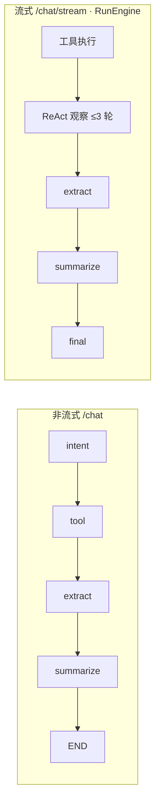
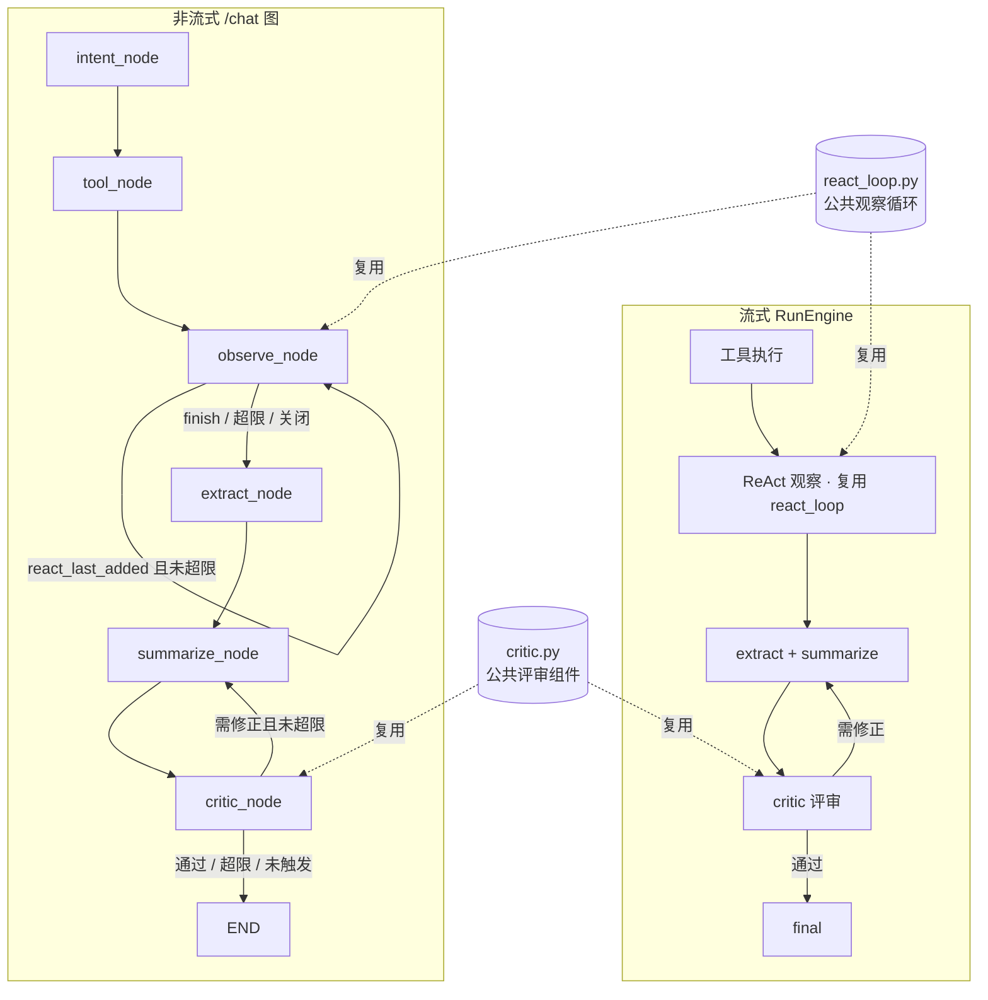

# ReAct 子图与 Critic 评审 —— 方案设计文档（P1）

> 目标：把 map_assistant_v1 从「固定工作流为主」升级为「领域智能体具备自主观察循环 + 高风险输出有 LLM 评审闭环」的多智能体协同雏形。
> 范围：`backend/agents/` 编排层；两条执行路径（非流式 LangGraph 图、流式 RunEngine）对称覆盖；含 §8 架构精简专项。
> 配套阅读：`Harness架构说明.md`（调度中枢）、`LangGraph节点状态说明.md`（图与状态基线）。
> **实施状态：✅ 已实施完成（2026-09）**——步骤记录、测试证据与实现差异见 **§12 实施状态记录**。

---

## 1. 背景与目标

### 1.1 现状判定

| 维度 | 现状 |
|---|---|
| 领域 Agent | `BaseAgent` 只是「提示词 + 工具白名单」静态容器，无自主循环 |
| 非流式图（`/chat`） | 固定流水线 `intent → tool → extract → summarize → END`，无运行时重建计划 |
| 流式路径（`/chat/stream`） | RunEngine 已有 ReAct 观察循环（`_react_observe`，≤3 轮，白名单 3 个只读工具）+ 确定性回退链 |
| 输出质检 | 仅确定性校验（validators / RulesGateway），无 LLM 语义评审 |
| 协同能力 | Agent 之间零通信；无评审者角色 |

结论：**两条路径能力不对称**（流式有 ReAct、非流式没有），且**高风险输出（报告/政策引用）缺少语义质检环节**。

### 1.2 本次目标（两项）

1. **ReAct 循环下沉与领域化**：
   - 把 `RunEngine._react_observe` 抽取为公共模块 `react_loop.py`；
   - 非流式图插入 `observe_node` 循环（工具结果 → LLM 观察 → 决定 finish / 追加步骤）；
   - 白名单从「全局 3 个只读工具」升级为「当前领域 Agent 的 tool_names ∩ 只读安全集」。
2. **Critic 评审闭环**：
   - 新增 `ResponseCritic`（qwen-flash），对**报告生成、知识检索**两类高风险输出做语义评审（事实一致性 / 来源标注 / 完整性）；
   - 不合格时带反馈重新生成（≤1 轮修正）；
   - 两条路径对称接入。

### 1.3 设计原则

| 原则 | 落地方式 |
|---|---|
| 确定性优先 | ReAct 仅追加**只读查询类**工具；Critic 无法判断时放行（宁可放过不可错杀） |
| 行为兼容 | `REACT_LOOP_ENABLED=0` / `CRITIC_ENABLED=0` 时行为与改造前**逐字节一致** |
| 单一实现 | 两条路径共用 `react_loop.py` 与 `critic.py`，避免双份逻辑漂移 |
| 渐进可回退 | 四个实施步骤各自独立提交、独立开关、独立可回退 |
| 成本纪律 | 观察与评审一律 qwen-flash + 超时 + 输入截断 + 轮数上限 |

---

## 2. 总体设计

### 2.1 改动前



### 2.2 改动后



### 2.3 交付物清单（文件级）

| 文件 | 动作 | 说明 |
|---|---|---|
| `agents/react_loop.py` | 新增 | 公共 ReAct 观察器（抽取自 `run_engine._react_observe`） |
| `agents/critic.py` | 新增 | 公共评审组件（触发判定 + 语义评审 + 降级） |
| `agents/nodes/observe_node.py` | 新增 | 非流式图观察节点（`ObserveNodeMixin`） |
| `agents/nodes/critic_node.py` | 新增 | 非流式图评审节点（`CriticNodeMixin`） |
| `agents/nodes/tool_node.py` | 改造 | 抽取 `_invoke_single_step` 供 observe 复用 |
| `agents/nodes/summarize_node.py` | 改造 | 支持 critic 反馈注入与重生成 |
| `agents/state.py` | 改造 | 新增 5 个状态字段 |
| `agents/task_executor.py` | 改造 | 图新增 2 个节点 + 2 条条件边；初始化 critic/observer |
| `agents/run_engine.py` | 改造 | `_react_observe` 改为薄包装；汇总阶段接入 critic |
| `.env` / `.env.template` | 改造 | 新增 CRITIC_* 环境变量块 |
| `tests/test_react_loop.py` `tests/test_critic.py` `tests/test_graph_observe.py` | 新增/扩展 | 单元与路由测试 |

---

## 3. 模块 A：公共 ReAct 循环（`agents/react_loop.py`）

### 3.1 抽取来源与行为基线

来源：`RunEngine._react_observe`（现实现，行为基线逐条保留）：

1. **短路省调用**：无知识库参与、且全部结果均"实质成功"→ 直接 finish（不调 LLM）；
2. **观察输入**：用户问题（≤600 字）+ 最近 8 条结果摘要（每条 ≤300 字，由调用方注入的 `summarize_fn` 生成）；
3. **LLM**：dashscope 原生调用，`REACT_OBSERVE_MODEL`（默认 qwen-flash），timeout 10s，要求输出单行 JSON；
4. **决策契约**：`{"decision": "finish"|"add_step", "tool", "params", "reasoning"}`；
5. **安全校验**：tool 必须 ∈ 白名单；params 必须为非空 dict；违规 → finish（记 warning）；
6. **异常降级**：任何异常（LLM 失败 / JSON 解析失败）→ finish，主流程不受影响；
7. **可观测**：`obs_generation(name="react_observe_rN")` 埋点（仅 RunEngine 传入 run_id 时）。

### 3.2 接口设计

```python
class ReActObserver:
    """领域无关的 ReAct 观察器：结果 → LLM 观察 → 追加步骤或 finish。"""

    def __init__(
        self,
        summarize_fn: Callable[[str, dict], str],   # 注入 executor._summarize_tool_result
        allowed_tools: Optional[Set[str]] = None,    # None = 全局安全集（默认 3 只读工具）
        max_rounds: Optional[int] = None,            # None = 读 REACT_MAX_ROUNDS（默认 3）
        model: Optional[str] = None,                 # None = 读 REACT_OBSERVE_MODEL
        prompt_extra: str = "",                      # 领域附加约束（预留）
    ): ...

    @property
    def enabled(self) -> bool:
        """REACT_LOOP_ENABLED（默认 1）。"""

    def observe(
        self,
        *,
        user_message: str,
        ordered_results: List[Dict],
        round_i: int,
        run_id: Optional[str] = None,
    ) -> Optional[TaskStep]:
        """返回待追加的 TaskStep 或 None（finish/降级/违规）。签名与现实现语义一致。"""
```

要点：

- **step_id 分配**在 observer 内部完成（`max(已有 step_id)+1`），与现实现一致；
- `allowed_tools=None` 时使用模块级安全集常量 `DEFAULT_READONLY_TOOLS = {knowledge_base_tool, postgresql_tool, web_search_tool}`；
- 领域化通过 `allowed_tools` 传入（见 §4.3），observer 本身不感知领域；
- 所有环境变量在 **observe 调用时**读取（不在 `__init__` 固化），保证测试可 monkeypatch。

### 3.3 RunEngine 改造

`_react_observe` 保留为薄包装（对外签名、事件、日志不变）：

```python
async def _react_observe(self, run_id, state, ordered_results, round_i):
    observer = self._react_observer  # __init__ 中构造，allowed_tools=None（全局安全集）
    return observer.observe(
        user_message=state.get("user_message", ""),
        ordered_results=ordered_results,
        round_i=round_i,
        run_id=run_id,
    )
```

守护：现有 `tests/test_react_loop.py` 全部用例保持通过，作为"行为不变"的回归证据。

---

## 4. 模块 B：非流式图 observe 循环

### 4.1 图结构变更（`task_executor._build_graph`）

```
intent_node ─(route_after_intent)─> tool_node ──> observe_node
                                        │            │  ▲
                                        │            │  └── (react_last_added=True 且未超限)
                                        │            ▼
                                        └────> extract_node <── (finish / 超限 / 关闭)
```

新增注册：

```python
graph.add_node("observe_node", self._observe_node)
graph.add_edge("tool_node", "observe_node")            # 替换原 tool_node → extract_node
graph.add_conditional_edges(
    "observe_node", self._route_after_observe,
    {"observe_node": "observe_node", "extract_node": "extract_node"},
)
```

**设计决策：observe_node 自环，不回 tool_node。**
原因：`tool_node` 每次进入都会重新执行 `execution_plan` 全量步骤（无幂等保护），回环会重复执行昂贵操作（报告生成、地图加载）。自环模式下 observe_node 只执行**它自己追加的单步**。

### 4.2 observe_node 单轮流程

```
1. observer.enabled 为 False 或轮数已达上限 → return {}（路由去 extract_node）
2. 读取 state["tool_results"]（此时已含 tool_node 结果 + 历轮追加结果）
3. step = observer.observe(user_message, results, round_i=react_rounds+1)
4. step is None → return {"react_last_added": False}
5. 执行追加步骤（复用抽取出的 _invoke_single_step）
6. return {"tool_results": [新结果], "react_rounds": n+1, "react_last_added": True}
```

**关键约定（reducer 安全）**：`AgentState.tool_results` 是 `Annotated[List, operator.add]`。新节点**必须返回部分更新 dict**——第 6 步只携带**本轮回新增的那一条**结果，由 LangGraph 的 add reducer 合并进总列表，**绝不能**返回 `[旧结果 + 新结果]` 的完整列表（会翻倍）。非 reducer 字段（`react_rounds` / `react_last_added`）按覆盖语义直接返回最新值。

### 4.3 领域白名单动态化

```python
# observe_node 内部
intent = state["intent_result"].primary_intent          # 注意 use_enum_values=True，是 str
agent = self.harness.dispatch(intent_result)             # IntentType → 领域 Agent
domain_tools = set(getattr(agent, "tool_names", []) or [])
observer = ReActObserver(
    summarize_fn=self._summarize_tool_result,
    allowed_tools=domain_tools & DEFAULT_READONLY_TOOLS,  # 领域 ∩ 只读安全集
)
```

效果对照：

| 意图 | 领域 | 动态白名单 |
|---|---|---|
| KNOWLEDGE_SEARCH | KnowledgeAgent | {knowledge_base_tool, web_search_tool}（postgresql 不在其 tool_names） |
| DATA_QUERY | DataAgent | {postgresql_tool} |
| UNKNOWN / CROSS_INTENT | GeneralAgent | 全部 3 个只读工具 |
| MAP_DISPLAY 等 | MapAgent | 空集 → observe 直接 finish（相当于关闭） |

空集时 observe 直接返回 finish——保持地图类操作零额外开销。

### 4.4 tool_node 抽取 `_invoke_single_step`

把现 `_tool_node` 内闭包 `_invoke_step` 提升为 Mixin 方法：

```python
async def _invoke_single_step(self, state: AgentState, step) -> Dict[str, Any]:
    """单步执行（TOOL_HUB_URL 外呼 → 本地 adapter 回退），tool_node 与 observe_node 共用。"""
```

`_tool_node` 内部改为调用该方法（逻辑逐字搬移，行为不变）；observe_node 复用同一实现，保证服务化路径（Tool Hub）与本地路径的待遇一致。

### 4.5 与确定性回退链的次序

现有次序保持：`tool_node`（含 DB→KB、KB→Web 两次确定性回退）→ **observe_node**（LLM 观察）→ `extract_node`。
即：确定性优先、LLM 观察兜后。critic 评审对象是最终 response（§5），与回退链无交互。

---

## 5. 模块 C：Critic 评审闭环

### 5.1 组件设计（`agents/critic.py`）

```python
class ResponseCritic:
    def __init__(self, summarize_fn=None): ...      # summarize_fn 用于构造工具结果摘要

    def should_review(self, intent_result, tool_results, response_text) -> bool:
        """触发判定（全部为确定性规则，不调 LLM）。"""

    def review(self, *, user_message, intent_result, response_text,
               tool_results) -> Optional[Dict]:
        """同步评审（dashscope）。返回 {"passed", "severity", "issues", "feedback"}；
        异常/超时 → None（调用方视为放行）。"""
```

### 5.2 触发判定 `should_review`（确定性）

同时满足才评审：

1. `CRITIC_ENABLED == "1"`（默认 1）；
2. response 非空且长度 ≤ `CRITIC_MAX_RESPONSE_CHARS`（默认 6000，超长跳过防止 prompt 爆炸）；
3. 命中触发范围（满足其一）：
   - `primary_intent ∈ {report_generation, knowledge_search}`；
   - `tool_results` 含成功产出的 `report_generator_tool` / `caisha_report_tool` / `knowledge_base_tool`（覆盖 cross_intent 生成报告的场景）。

明确排除：`map_display / data_query / data_visualization / weather_query / location_search` 等操作性意图——无需语义评审，零开销。

### 5.3 评审契约与维度

**输入**：用户问题 + 意图 + 草拟回答 + 工具结果摘要（`summarize_fn` 逐条截断 300 字、最多 8 条，与 ReAct 观察同一经济口径）。

**输出（单行 JSON）**：

```json
{"passed": true, "severity": "ok", "issues": [], "feedback": ""}
{"passed": false, "severity": "major", "issues": ["引用许可号"豫罗砂许〔2023〕第01号"未在工具结果中出现"], "feedback": "删除或更正该许可号，仅保留工具结果中出现的原文…"}
```

**评审维度（prompt 固定四条）**：

1. **事实一致性**：数字、名称、许可号、结论是否与工具结果矛盾或凭空出现；
2. **来源标注**：知识类回答引用具体文档结论时是否标注来源（项目既有规则）；
3. **完整性**：是否直接回答用户问题；报告类是否说明生成结果或跳过原因；
4. **无过度承诺**：不虚构系统不具备的能力。

**放行规则（保守优先）**：信息不足以判断 → `passed=true`；评审模型自身失败/超时/JSON 异常 → 调用方视为放行。宁漏检不错杀。

### 5.4 非流式图接入（summarize ⇄ critic 循环）

新增 `critic_node`（`CriticNodeMixin`）与条件边：

```python
graph.add_edge("summarize_node", "critic_node")
graph.add_conditional_edges(
    "critic_node", self._route_after_critic,
    {"summarize_node": "summarize_node", END: END},
)
```

`critic_node` 流程：

```
1. should_review 否 → return {}（路由去 END）
2. 轮数超限（_critic_round > CRITIC_MAX_ROUNDS，默认 1）→ 记 warning 日志，return {}（放行）
3. review() 返回 None（异常）或 passed → return {}（放行）
4. 不通过 → return {
       "response": "",                # 清空，触发 summarize_node 重新生成
       "_critic_feedback": feedback,
       "_critic_issues": issues,
       "_critic_round": round+1,
   }
```

对应 `summarize_node` 两处必要改造：

```python
# ① 短路条件：修正轮不短路
if state.get("response") and not state.get("_critic_feedback"):
    return state

# ② rich 透传：修正轮禁用（必须走 LLM 修正），并注入反馈
feedback = state.get("_critic_feedback")
rich_content = None if feedback else self._try_extract_rich_response(tool_results)
response_text = self._generate_response(..., critic_feedback=feedback)
# 生成完成后清空反馈标记，防止死循环
state["_critic_feedback"] = None
```

`_generate_response` 新增可选参数 `critic_feedback`：非空时在 user_content 追加修正指令（"上一版回答存在以下问题：…，请修正后重新输出完整回答，不要提及修正过程"）。

**循环安全**：`_critic_round` 只增不减 + `CRITIC_MAX_ROUNDS=1` ⇒ 最多"生成 → 评审 → 修正 → 评审 → 结束"两次评审、一次修正。

### 5.5 流式路径接入（RunEngine）

位置：`state = executor._summarize_node(state)` 之后、`workspace.record` / `_emit_final` 之前。

```python
critic = self.executor.critic
if critic.should_review(intent_result, state.get("tool_results"), state.get("response")):
    await self._emit(run_id, "status", "critic", title="质量评审中", ...)
    verdict = await loop.run_in_executor(None, critic.review_sync, ...)   # 不阻塞事件循环
    if verdict and not verdict["passed"]:
        await self._emit(run_id, "status", "critic_revise", title="根据评审意见修正答复", ...)
        state["_critic_feedback"] = verdict["feedback"]
        state["response"] = ""
        state = self.executor._summarize_node(state)
        await self._emit(run_id, "status", "critic_done", ...)
```

两个细节：

- **线程池调用**：评审在最终阶段，不能阻塞 asyncio 事件循环（10s 超时会影响并发请求），统一 `run_in_executor`；
- **事件类型沿用现有 `status` 通道**：前端对 `status` 已有渲染逻辑，无需前端改动；专属评审卡片留到 P2。

### 5.6 与 RulesGateway / validators 的分工

**两层正交**：网关管"工具能不能执行、结果有没有"（操作安全，确定性规则）；critic 管"话有没有说对"（表达质量，LLM 语义判断）。

**RulesGateway 现状**（本次不改造，仅作为 critic 的职责边界）：

- 机制：按工具注册 `preflight(tool)` / `postflight(tool)` 校验链，统一产出 `VerificationReport{passed, checks[], risk: none|warning|critical}`；critical 触发 fail-fast（`run_engine._invoke_step` 读取 risk，跳过依赖步骤并发出 verification 事件，复用"数据不足跳过报告 / DB 空回退知识库"语义）；
- 职责边界：网关只负责"验证"，"回退编排"仍留在 TaskExecutor（`_fallback_knowledge_search`）；
- 现有校验函数全清单：

| 文件 | 函数 | 管什么 | 阶段 |
|---|---|---|---|
| `validators/db_validators.py` | `check_empty_result` | 查询结果为空 | postflight |
| | `check_aggregate_zero` | 聚合结果全零 | postflight |
| | `check_kb_content_empty` | 知识库检索内容为空（触发回退链） | postflight |
| `validators/gis_validators.py` | `check_crs_metric` | CRS 是否支持米制运算 | preflight |
| | `check_workflow_steps_failed` | QGIS 工作流步骤失败 | postflight |
| | `check_geojson_features` | GeoJSON 要素数有效性 | postflight |
| `validators/report_validators.py` | `check_output_conflict` | 输出路径冲突 | preflight |
| | `check_file_exists` | 报告文件存在性 | postflight |
| | `check_chart_series_nonempty` | 图表 series 非空 | postflight |

**分工对照（同一场景，两层各查什么）**——以"生成某县采砂监测报告"为例：

1. 执行前（网关 preflight）：`check_crs_metric`（投影能否米制运算）、`check_output_conflict`（输出文件是否冲突）；
2. 执行后（网关 postflight）：`check_file_exists`（报告文件真的生成了吗）、`check_chart_series_nonempty`（图表有数据吗）；
3. 回复生成后（critic）：回答正文中的数字/县名与查询结果一致吗？引用文档结论时标注来源了吗？报告被数据不足跳过时说明了原因吗？

**网关绿灯 + critic 红牌是完全可能的**：文件生成成功、图表非空（网关全过），但正文把县名或数字写错（critic 拦截）——这正是两层不可互相替代的原因：

| 维度 | RulesGateway | critic |
|---|---|---|
| 判定对象 | 结构化事实（文件、列表、CRS、路径） | 自由文本 vs 结构化结果的**语义对照** |
| 手段 | if 判断（零成本、必达） | LLM（有成本、有误判率） |
| 覆盖范围 | 全部工具、全部请求 | 仅 report_generation / knowledge_search |
| 失败动作 | fail-fast / 触发回退链 | 带反馈重生成（≤1 轮） |

**数据流衔接（future，本期不做）**：postflight 的 `VerificationReport` 可作为 critic 输入的一部分——"报告因数据不足被跳过"这类结论应传达给 critic 作为上下文，避免 critic 把"如实说明跳过"误判为"未完成"。

---

## 6. 状态、事件与环境变量

### 6.1 AgentState 新增字段（`state.py`）

```python
react_rounds: int                     # 非流式图 ReAct 已用轮数（覆盖语义）
react_last_added: bool                # 最近一轮是否追加了步骤（路由依据）
_critic_feedback: Optional[str]       # 评审反馈（待修正指令）
_critic_issues: List[str]             # 评审问题清单（日志/埋点）
_critic_round: int                    # 评审轮数（循环保护）
```

`execute()` 的 `initial_state` 同步补默认值（0 / False / None / [] / 0）。

### 6.2 环境变量汇总

| 变量 | 默认 | 状态 | 说明 |
|---|---|---|---|
| `REACT_LOOP_ENABLED` | `1` | 已有 | ReAct 总开关（两条路径共用） |
| `REACT_MAX_ROUNDS` | `3` | 已有 | 观察轮数上限 |
| `REACT_OBSERVE_MODEL` | `qwen-flash` | 已有 | 观察模型 |
| `CRITIC_ENABLED` | `1` | **新增** | 评审总开关 |
| `CRITIC_MODEL` | `qwen-flash` | **新增** | 评审模型 |
| `CRITIC_MAX_ROUNDS` | `1` | **新增** | 最大修正轮数 |
| `CRITIC_TIMEOUT` | `12` | **新增** | 评审超时（秒） |
| `CRITIC_MAX_RESPONSE_CHARS` | `6000` | **新增** | 超长响应跳过评审 |

所有新开关关闭时，程序行为与当前生产版本完全一致。

### 6.3 可观测性

- `obs_generation`：`react_observe_rN`（已有）、新增 `critic_review`（含 prompt/completion/耗时）；
- 日志：`[ReAct] rN 追加步骤 …`、`[Critic] 评审不通过 issues=…`、`[Critic] 放行（异常降级）`；
- 流式事件：`critic` / `critic_revise` / `critic_done` 三个 status 事件（前端零改动，可后续做专属卡片）。

---

## 7. 测试计划

### 7.1 单元测试

| 用例 | 断言 |
|---|---|
| `react_loop` 短路 | 全实质成功且无 KB → 不调 LLM 返回 None |
| `react_loop` 白名单 | 领域交集为空 → 直接 finish；非法工具 → finish 并 warning |
| `react_loop` 降级 | LLM 异常 / JSON 坏 → None |
| `critic.should_review` | 报告/知识命中；地图/数据不触发；超长响应不触发；开关关闭不触发 |
| `critic.review` 放行 | 异常/超时 → None；passed=true → 放行 |
| `critic` 打回 | major issues → passed=false + feedback 非空 |

### 7.2 图路由测试（新增 `test_graph_observe.py`）

| 用例 | 断言 |
|---|---|
| observe 自环 | 首轮追加 → `react_last_added=True` → 路由回 observe_node |
| observe 结束 | finish → 路由 extract_node；轮数超限 → extract_node |
| reducer 安全 | 两轮追加后 `tool_results` 总数 = tool_node 结果 + 2（无翻倍） |
| critic 回环 | 打回后 response 清空、summarize 重入、`_critic_feedback` 被消费且不残留 |
| critic 超限 | `_critic_round > CRITIC_MAX_ROUNDS` 时直接 END（防死循环） |

### 7.3 回归与端到端

- **回归**：现有 109 用例全绿；重点 `test_react_loop.py`（RunEngine 行为不变）、`test_run_engine.py`；
- **端到端场景**：
  1. "生成商城县采砂监测报告" → 报告生成 → critic 评审（触发）→ 通过；
  2. "河道采砂许可有什么要求" → KB 检索 → critic 评审（来源标注）→ 通过；
  3. "切换到卫星底图" → MapAgent 空白名单 → observe 直通、critic 不触发（零开销验证）；
  4. 构造"知识库空"场景 → 观察轮追加联网搜索（ReAct 生效验证）。

### 7.4 指标基线（上线后观测）

- critic 触发率（应 ≤ 30% 请求）、评审通过率（健康值 > 85%）、平均延迟增量（目标 < 2s）、ReAct 追加成功率。

---

## 8. 架构精简专项（提炼）

> 动因：智能体层实测 38 个 py 文件 / 8079 行、15+ 个需要理解的机制概念——「能跑」但「难懂、难加」。本专项把架构从「多机制拼装」提炼为「内核 + 声明」形态，与 P1 主方案共用同一套验收（测试全绿 + 行为不变）与回滚纪律。

### 8.1 体检数据（实测）

| 指标 | 现状 | 说明 |
|---|---|---|
| 文件 / 行数 | 38 个 py 文件 / 8079 行 | `backend/agents/` 全量（实测） |
| 最大文件 | `run_engine.py` 1207 行 | 单文件含 7 种职责：SSE API、工具执行、确定性回退、ReAct 观察、报告编排、汇总调用、事件发射 |
| 重复实现 | `_invoke_step` 两份（RunEngine 方法 / tool_node 闭包）；`_fallback_knowledge_search` / `_fallback_web_search` 两份 | 两条执行路径各写一份；历史上已多次为「双路径同步」付出修复成本（kb_sources 透传遗漏、KB→Web 回退补全等） |
| 领域 Agent | 6 个文件 437 行（base 44 / map 114 / data 72 / knowledge 38 / report 55 / general 114） | 每个类实际只有 4 个成员声明（intent / tool_names / 两个 prompt），本质是数据 |
| 策略机制壳 | `providers/` 三套「基类 + 装饰器 + registry + resolve」共 194 行机制壳 | registry 46 + plan_correction 74 + kb_fallback 74；实现体 885 行（intent_corrections 391 + sandfield 265 + sandfield_kb 229） |
| 工具特化分支 | `extract_node.py` 529 行内 4 个工具 rich 分支 + `tool_node.py` 713 行内 qgis/报告特化 | `if tool_name == "xxx"` 模式散落 3 处节点，新增 1 个工具需改 5~6 处 |

### 8.2 四个臃肿根因

1. **双编排并存**（最大根因）：LangGraph 图与 RunEngine 手工编排实现同一语义（工具执行 / 回退 / 汇总）——两份实现、两份维护、行为漂移风险；
2. **工具特化发散**：工具特殊性以 if-else 形式散落在 tool_node / extract_node / summarize_node，加工具=改多处；
3. **机制样板重复**：providers 三套注册表机制、nodes 五个 Mixin、六个 Agent 类——每套单独看都合理，合起来概念爆表；
4. **职责混杂**：`run_engine.py` 一文件 7 种职责；`intent_types.py` 混枚举 + 县域映射 + 工具映射。

### 8.3 提炼后的目标形态（1 + 2 + 3）

```
1 个编排内核：一张 LangGraph 图 + 一条事件流（SSE 桥）——流式/非流式走同一执行路径
2 个协同机制：观察循环（react_loop）+ 评审闭环（critic）——公共契约、领域参数化
3 层职责：编排（图）/ 能力（工具 + ToolCapability 声明表）/ 保障（RulesGateway + validators + critic）
支撑层（不精简）：黑板（workspace_state / event_bus / fact_memory）、持久化（run_store）、知识（kb_pipeline）
```

概念收敛对照（需要理解的心智负担）：

| 概念 | 现状 | 精简后 |
|---|---|---|
| 执行路径 | 2 条（图 / RunEngine 手工编排） | 1 条（图驱动，RunEngine 降级为流式宿主） |
| 工具特异性表达 | 散落 3 处节点的 if-else | 1 张 ToolCapability 声明表 |
| 领域 Agent | 6 个类 + 1 个抽象基类（4 抽象方法） | 1 张声明表（BaseAgent 保留为扩展点） |
| 策略注册机制 | 3 套（registry / plan_correction / kb_fallback） | 1 个泛型注册器 |
| 智能体角色 | 无（仅执行者） | 执行者 + 观察者 + 评审者 |

### 8.4 三档精简路线（与 P1/P2 绑定）

**A 档 · 零风险静态整理（并入 P1 顺手做，不单独占用里程碑）**

1. `_invoke_step` 双份收敛（并入 S2）：在抽取 `_invoke_single_step` 的同时，把 RunEngine 的 `_invoke_step` 改为复用同一执行内核（TOOL_HUB → adapter → postflight），RunEngine 侧仅保留事件发射与 obs 埋点包装；
2. `providers/` 三套机制壳合并为一个泛型注册器（～50 行），各策略实现不动——样板 194 行 → ～80 行，机制概念 3 → 1；
3. `intent_types.py` 拆分（枚举/描述 | 县域与工具映射配置）——可选、低优先；
4. 死代码扫描（unused import / 未引用方法），随 S1~S3 各步顺带。

**B 档 · 声明式收敛（P1.5，预计 1~2 天）**

5. 新增 `tool_capabilities.py`：每个工具声明「rich 透传策略 / 结果摘要策略 / 来源追加 / 数据充分性判定」，`extract_node` / `tool_node` / `summarize_node` 改为查表——消灭特化 if-else；
6. 6 个领域 Agent 收敛为 `domain_agents.py` 一张声明表（提示词常量集中），`BaseAgent` 保留为扩展点。

**C 档 · 单编排内核（P2，预计 3~5 天，前置条件：P1 的 react_loop / critic 稳定运行）**

> 详细设计见《单编排内核（C档）设计方案.md》（独立文档：事件契约冻结表、pending 图化、迁移步骤 C1~C4）。

7. **图驱动流式**：`/chat/stream` 改为执行同一张 LangGraph 图（节点内事件发射 + 宿主生命周期），RunEngine 从 1207 行降级为 ≤400 行的「Run 宿主」（生命周期 + 事件契约 + final 组装）；
8. 随之删除 RunEngine 内的工具执行 / 回退 / 观察 / 报告编排副本（由 A-1 与 C-7 共同消除）。

### 8.5 验收指标

| 指标 | 现状 | A 档后 | C 档后（目标） |
|---|---|---|---|
| 核心概念数 | 15+ | ~12 | ≤8 |
| 最大文件行数 | 1207（run_engine） | ≤900 | ≤400 |
| 双份实现 | 2 组 | 0 | 0 |
| 新增一个工具的改动文件数 | ~6 | ~6 | ≤3（capability 声明 + registry + 提示词） |
| agents/ 文件数 | 38 | ~36 | ≤25 |

### 8.6 精简边界（防止过度设计）

- **不动**：RulesGateway / validators（正交职责清晰）、kb_pipeline（知识职责完整）、providers 的确定性策略本身（业务价值高）、event_bus / workspace_state / fact_memory / run_store（基础设施稳定）；
- **原则**：减「机制样板」与「重复实现」，不减「确定性能力」；任何精简不得改变对外行为；
- **次序**：先 A 后 B 再 C——每档独立可交付、独立可回退。

---

## 9. 实施步骤（预计 3~5 天）

| 步骤 | 内容 | 交付物 | 验收 |
|---|---|---|---|
| **S1（0.5~1 天）** | 抽取 `react_loop.py`；RunEngine 改薄包装 | 模块 + RunEngine 改造 | 现有测试全绿（行为不变） |
| **S2（1~1.5 天）** | `_invoke_single_step` 抽取（含 RunEngine `_invoke_step` 双份收敛，§8.4-A1）；`observe_node` + 图变更 + 状态字段 | 节点 + 图 + 路由测试 | 新增路由测试 + 回归全绿；端到端场景 4 |
| **S3（1 天）** | `critic.py` + `critic_node` + summarize 改造 | 组件 + 节点 + 单元测试 | 场景 1/2 端到端 + 防死循环测试 |
| **S4（0.5~1 天）** | RunEngine 接入 critic；`.env`/模板更新；文档更新（Harness/LangGraph 说明补节） | 全量交付 | 全量 pytest + 生产灰度验证 |

每步独立 commit；任何一步出问题仅 revert 该步，前序步骤不受影响。A 档静态整理（§8.4）随 S1~S4 穿插执行。

---

## 10. 风险与回滚

| # | 风险 | 缓解 |
|---|---|---|
| 1 | 延迟增量（观察 + 评审各 1~2 次 flash 调用） | 短路逻辑、flash 模型、timeout、响应长度上限；目标增量 < 2s |
| 2 | `tool_results` reducer 翻倍 | 新节点强制"部分更新"约定 + 专项测试（§7.2） |
| 3 | summarize 重入引发死循环 | `_critic_round` 只增不减 + 上限判定在任何生成之前 |
| 4 | critic 误杀正确回答 | 保守放行策略（不确定=放行）+ 仅 1 轮修正 + 全量日志可回溯 |
| 5 | 两条路径行为漂移 | 单一公共实现（react_loop / critic）+ 对称测试用例 |
| 6 | 观察循环放大旧行为变更 | `REACT_LOOP_ENABLED=0` 一键回到现状 |
| 7 | 精简重构引入行为回归 | 三档推进（§8.4），每档独立提交；验收与 P1 相同：测试全绿 + 行为不变 |
| 8 | 精简范围蔓延 | §8.6 边界清单明确"不动"项；B/C 档以 P1 稳定运行为前提 |

**回滚操作**：`CRITIC_ENABLED=0`（评审下线）；`REACT_LOOP_ENABLED=0`（观察循环下线，两条路径同时生效）；代码级 `git revert` 对应 commit。

---

## 11. 附录

### 11.1 关键代码锚点（改造前基线）

| 目标 | 位置 |
|---|---|
| ReAct 現实现 | `run_engine.py` `_react_observe` / `REACT_ALLOWED_TOOLS` / 循环调用处（工具执行段） |
| 非流式图定义 | `task_executor.py` `_build_graph` |
| 单步执行闭包 | `tool_node.py` `_tool_node` 内 `_invoke_step` |
| 响应生成 | `summarize_node.py` `_summarize_node` / `_generate_response` |
| rich 透传 | `extract_node.py` `_try_extract_rich_response` |
| 状态定义 | `state.py` `AgentState` |
| 领域分派 | `agent_harness.py` `dispatch` / `AgentHarness` |
| 校验链 | `rules_gateway.py` + `validators/*` |

### 11.2 与后续演进（P2）的衔接

- `observe_node` / `critic_node` 均以 Mixin 形式挂载，后续可整体升级为 LangGraph 子图（subgraph）而不影响图外接口；
- `critic.py` 的评审契约（passed/issues/feedback）可直接被 P2 的"报告评审子图"或"双 Agent 交叉验证"复用；
- 流式 critic 事件（critic/critic_revise/critic_done）已铺好数据链路，P2 前端可升级为协作时间线卡片。

---

## 12. 实施状态记录（2026-09 完成）

> 本节为实施完成后的回填记录，供后续维护者对照设计稿与实际交付。

### 12.1 步骤完成情况

| 步骤 | 状态 | 实际交付物 |
|---|---|---|
| S1 | ✅ 完成 | `agents/react_loop.py`（198 行）；`RunEngine._react_observe` 薄包装；`tests/test_react_loop.py` |
| S2 | ✅ 完成 | `_invoke_single_step` 内核抽取（`tool_node.py`；含 A 档 A-1：RunEngine 双份 `_invoke_step` 收敛至同一内核）；`agents/nodes/observe_node.py`；图变更（observe_node + 自环条件边）；`state.py` +2 字段；`tests/test_graph_observe.py` |
| S3 | ✅ 完成 | `agents/critic.py`；`agents/nodes/critic_node.py`；summarize 四处改造（短路 / rich 透传禁用 / 反馈注入 / 反馈消费）；`state.py` +3 字段；图接入（critic_node + 回环条件边）；`tests/test_critic.py` |
| S4 | ✅ 完成 | `RunEngine._critic_review_stream`（评审 / 打回修正 / 三事件 / 埋点 / 降级）；`.env` + `.env.template` CRITIC 配置块；文档更新（《LangGraph节点状态说明.md》§19、《Harness架构说明.md》§8） |

### 12.2 测试证据

- 全量回归：**130 passed**（较改造前基线 114 增加 16 个用例，零失败）；
- 专项覆盖：`test_react_loop.py`（观察器单元）、`test_critic.py`（触发矩阵/评审契约/异常降级）、`test_graph_observe.py`（图内自环 + 评审回环 + 防死循环 + 零开销）、`test_run_engine.py`（流式三事件 + 打回修正 + 降级直出）；
- 命令：`cd backend && python -m pytest tests/ -q`（需项目虚拟环境中的 pytest）。

### 12.3 与设计稿的实现差异（重要）

| 差异点 | 设计稿 | 实际实现 | 原因 |
|---|---|---|---|
| 循环配额语义 | §5.4 伪代码逐步跟踪在 `CRITIC_MAX_ROUNDS=1` 下会产生「3 评 2 修」 | 实现为「≤2 评 ≤1 修」（入口守卫 + 打回前配额检查） | 与设计稿自身承诺的“最多两次评审、一次修正”对齐；防死循环测试锁定 |
| 流式修正次数 | §5.5 伪代码（单轮修正，无二次评审） | 与伪代码一致（流式仅 1 次修正） | 修改后直接收尾，不再复审；评审/重生成均在线程池执行，不阻塞事件循环 |
| 流式接入位置 | “汇总阶段接入” | 主路径 `_summarize_node` 调用后接入（直答分支不接入） | 直答分支无工具结果可对照，符合“信息不足→ 放行”语义 |

### 12.4 相关文档

- 图 / 节点 / 状态 / 流式的完整说明：《LangGraph节点状态说明.md》§19（P1 架构演进——两个受控回环）；
- Harness 视角的组件表与分工：《Harness架构说明.md》§8（P1 协同机制）。
