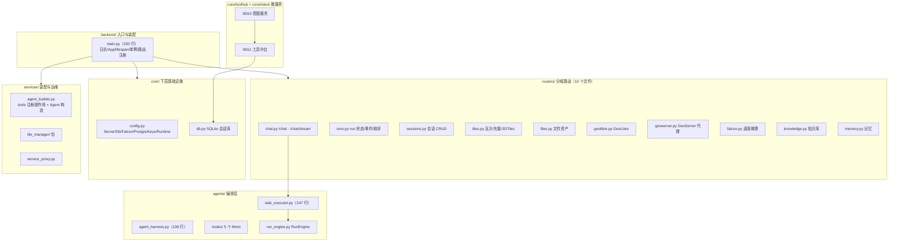
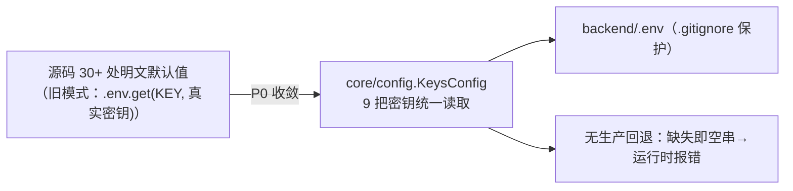
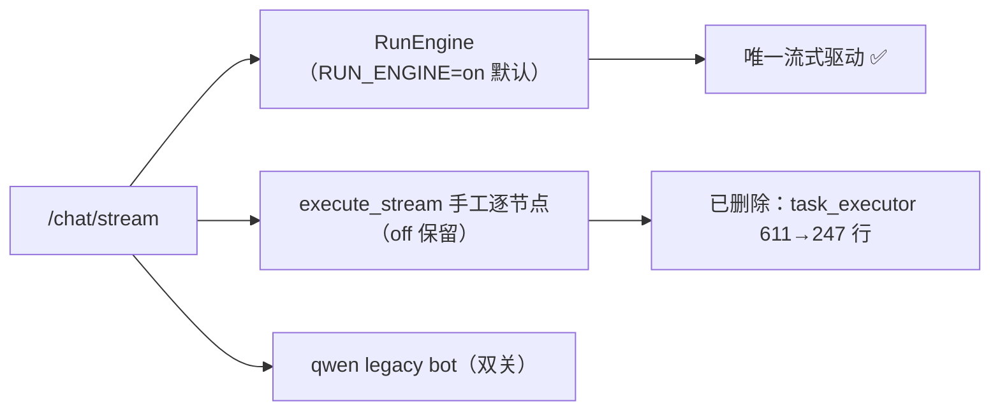
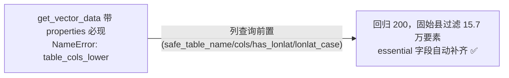

# Smart_Map 第二轮架构优化 — 改动说明

> 时间：2026-09-08 · 覆盖提交：`32314f64` → `006c8e9d`（main + 8 commits）
> 执行依据：《smart-map-架构优化方案-第二轮.md》（P0 安全收敛 / P1 agents 编排 / P2 路由工程 / P3 前端拆分）
> 本轮目标：**巨石收敛 → 密钥入 .env → 编排去冗余 → 存量 bug 清零 → 前端公共层去重**

---

## 一、改动总览

| # | commit | 阶段 | 一句话 |
|---|--------|------|--------|
| 1 | `32314f64` | main 收敛 | main.py 1393→200 行，纯入口装配 + 全域归位 |
| 2 | `a10fc427` | security(P0) | 9 把密钥收敛 `backend/.env`，源码 30+ 处明文清零，CI 密钥门禁 |
| 3 | `b43c97b7` | refactor(P1) | agents 编排收敛：`__init__` 修复 / AgentHarness 瘦身 / 双源路由表单源 |
| 4 | `193ff9ed` | refactor(P1) | SSE 流式收敛 **RunEngine 单驱动**，删除 execute_stream 手工编排 |
| 5 | `1740541d` | refactor(P2) | chat.py 拆分出 runs / sessions 两新路由 |
| 6 | `7ad1ddc2` | fix(P2) | 存量 bug：vector-data properties 路径 + files datetime/硬编码 |
| 7 | `006c8e9d` | refactor(P3) | 前端公共层：`utils/geo` + common 弹窗（消除复制粘贴） |
| 8 | （进行中） | P3 深度 | MapManager/Cesium 分区/App 拆分等留档后续 |

### 当前后端文件归属（重构后）

---

## 二、`main.py` 收敛为纯入口（`32314f64`）

**变更前**：1393 行，混着「拆分残留空壳注释区 + 43 个死导入 + vector-data 业务 + 超长系统提示 + 重复常量」。

**变更后**：200 行，只做「装配」。

| 迁移物 | 去向 |
|--------|------|
| SQLite 会话存储（init_db/get_db/now_iso/DB_PATH + 旧路径迁移） | 新建 `backend/core/db.py` |
| tools 注册副作用 + TaskExecutor / 旧 Qwen Assistant 装配 | 新建 `backend/services/agent_builder.py` |
| 296 行旧版系统提示 | `backend/prompts.py` → `LEGACY_ASSISTANT_SYSTEM_PROMPT` |
| `/api/vector-data` + filter 校验 | `backend/routers/tiles.py` |
| OCR/上传/SSE 常量、chat 辅助函数 | `backend/routers/chat.py` |
| SHP/GeoJSON 目录常量 | `backend/routers/files.py` |
| Falcon 常量 / GeoLibre 默认样式 | `routers/falcon.py` / `routers/geolibre.py` |

**约束达成**：全库 router 不再 `from main import ...`（仅 chat.py 保留 `import main as _main` 访问 lifespan 单例 `task_executor/bot`）；backend 根目录仅剩 3 个运行时模块（main / prompts / cesium_bridge_server）。

---

## 三、P0 安全与配置收敛（`a10fc427`）

### 3.1 密钥单一来源 = `backend/.env`

- 收敛清单：DashScope / RagFlow(3) / Dify(3) / 天地图 / 和风天气 + PG 口令；
- `.env.template` 全占位化（移除真实口令），新增 `frontend/.env.template`；
- `ecosystem.config.js` 去除明文 key 注入（改由 main `load_dotenv` 加载）；
- `config.py` 新增 `KeysConfig` 与 `RuntimeConfig`（4+2 个 dataclass 域）。

### 3.2 工程清理

- `MAPASSIST_DB_PATH` 三处重复解析 → 统一引用 `core/db.py`；
- backend 根 6 个一次性脚本归位 `scripts/`（含脱敏 + dotenv 加载兜底），删除与 `/proxy/gf-tiles` 重复的 `proxy_example.py`；
- CI 新增 `secret-scan` job（`sk-`/`ragflow-`/`dataset-`/`eyJ`/`AKIA`/`ghp_` 门禁）。

---

## 四、P1 agents 编排收敛

### 4.1 修复（`b43c97b7`）

| 问题 | 处理 |
|------|------|
| `agents/__init__.py` 尾部残留短块**覆盖**完整 `__all__`（星号导入丢 6 符号） | 删除残留块，恢复 11 个导出 |
| AgentHarness 构造重复 `IntentAgent`/`ToolRegistry`（TaskExecutor 已各持一份且 harness 自建后未用） | __init__ 只保留 llm_cfg + 快速路由 + 懒加载 Agent 字典 |
| 快速路由表双维护：`FAST_ROUTE_KEYWORDS`（60 条）vs `fast_route_loader`（44 条） | 删除 harness 内第二份表，统一走 loader（JSON 权威 + 内置默认补全 spatial_analysis 10 条）|
| 工具工厂 host 内联 + 5 处 `KNOWLEDGE_BACKEND` 分支重复 | postgres/knowledge 工厂改读 `core.config`；新增 `RuntimeConfig.knowledge_backend` 供 5 处共用 |

### 4.2 SSE 流式单驱动（`193ff9ed`）

**变更前** `/chat/stream` 有三条驱动：

- 删除 `task_executor.execute_stream` 手写生成器（约 330 行）与 chat 对应分支；
- 语义：`executor.run_engine` 可用即走 RunEngine（独立 task，断线不中断）；双关全关才回退 legacy bot；
- 端到端回归：SSE `intent 0.98 → weather_tool → 联网降级 → final 回答 + 来源标注`。

---

## 五、P2 路由与存量 bug（`1740541d` + `7ad1ddc2`）

### 5.1 chat.py 拆出新路由

| 新文件 | 承载 | 原 chat.py 行数 |
|--------|------|-----------------|
| `routers/runs.py` | run 状态查询 / 事件断线补拉 / 取消 / suggestions | −50 |
| `routers/sessions.py` | 会话列表/新建/删除/重命名/历史消息（模型随迁） | −90 |

chat.py 专注聊天主链路（1112→972 行）。

### 5.2 存量 bug 修复

- `routers/tiles.py`：目标表列查询整体上移到 properties 分支之前；
- `routers/files.py`：修复 `datetime` 未定义；screenshots/reports 目录由 `/home/server` 硬编码改为 backend 相对路径。

---

## 六、P3 前端公共层（`006c8e9d`）

本轮完成**公共层 + 卫生**，深度拆分见「遗留」。

| 变更 | 说明 |
|------|------|
| 新建 `src/utils/geo.js` | `riskDiffToRGB` 单一来源（原 MapComponent/CesiumComponent 双份复制已统一 import）；附 `convexHull` |
| 新建 `src/components/common/` | `FileBrowser.jsx` / `ConfirmDeleteModal.jsx`（原 TileManager 内联 190 行抽出，GisPipeline 可复用）|
| TileManager.jsx | 2886 → 2694 行 |
| 仓库卫生确认 | `frontend/build` 已在 `.gitignore`（无构建产物入库）|
| 验证 | `npm run build` 通过 |

---

## 七、配置与新增约定（写代码前请读）

| 约定 | 内容 |
|------|------|
| 新增环境变量 | 在 `backend/core/config.py` 相应 dataclass 声明 + `.env.template` 登记，**禁止业务代码直读** `os.environ.get(KEY, 真实值)` |
| 密钥 | 只放 `backend/.env`；`KeysConfig` 无生产回退；template 全占位 |
| `KNOWLEDGE_BACKEND` | 统一经 `core.config.runtime.knowledge_backend`（5 处已收敛）|
| DB 路径 | 统一经 `core.db.DB_PATH`（fact_memory / run_store / core.db / main 同源）|
| 新增工具 | `tools/*_tool.py` + `tools.yaml` 元数据（≤2 处），工厂 cfg 从 `core.config` 取 |
| 新增路由 | 放进 `routers/` 对应域文件，`main.py` 只做 include |

---

## 八、验证与线上状态

- **openapi**：94 条路径每阶段与基线 diff 为空（拆分只搬家不改 API）；
- **pytest**：91 用例全绿（含 P2 新增的服务回退/registry 契约测试）；
- **SSE 端到端**：RunEngine 全链路实测通过；
- **CI**：pytest + frontend build + secret-scan 三 job；
- **线上**：`pm2 restart map-assistant-backend` 已执行，root / openapi / sessions / vector-data(带 properties) 冒烟全部 200。

---

## 九、遗留与后续（P3 深度拆分）

| 优先级 | 事项 |
|--------|------|
| 1 | `MapComponent.jsx`：抽 `MapManager.js`（Leaflet 命令式控制器，约 1470 行）与 `LabelManager.js` |
| 2 | `CesiumComponent.jsx`：按注释分区拆 `cesium/{presets,commands,geoUtils,measureTools}.js` |
| 3 | `TileManager / KnowledgeBaseManager / GisPipeline / FalconPanel`：按 tab/子面板拆组件 + 数据 hook |
| 4 | `App.jsx`：工具函数入 utils，拆 ChatPanel/MessageList/命令分发器（命令语义可复用 2D/3D）|
| 5 | 状态管理评估（当前 props + MapManager 上抛 + window CustomEvent 混合）|

> 每步独立 commit，沿用「npm run build + 功能冒烟」验收；子代理体检已给出逐文件拆分边界，风险低。
